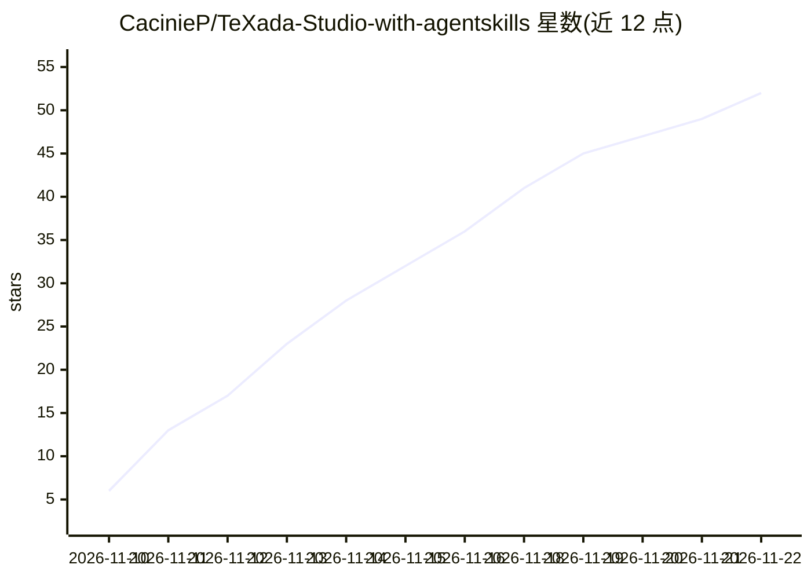

# CacinieP/TeXada-Studio-with-agentskills

⭐ 52 · Python · AGPL-3.0 · 推送 2026-11-17 · [GitHub](https://github.com/CacinieP/TeXada-Studio-with-agentskills) · [官网](https://github.com/CacinieP/TeXada-Studio-with-agentskills/blob/main/docs/local-studio.md) · 个人维护 · 中文 README

**本地 LaTeX 工作台：双栏编辑、图片识别与保真公式修复审阅**

在浏览器中打开的本地单用户 LaTeX 工作台：提供源码/中文 PDF 双栏工作区、LaTeX 高亮补全、五类模板、公式语法检查、编译预览与 PDF 导出；可导入 PNG/JPEG/WebP/PDF（每次最多 5 页）做识别并审阅 LaTeX 候选。修复分两层：保留原文的确定性语法修复不需模型；模型候选经语法与修改范围校验后以 diff 呈现，需明确采用或拒绝。本机模型仅接受 localhost 的 OpenAI 兼容端点，默认 MiniCPM-V 4.7 35B Q4（约 22.3GB 权重，建议 32GB 内存起步），不会自动改用云模型。自述仍为开发候选、无正式 Release；多文件工程与多人协作未纳入范围。

## 筛选速览

| 维度 | 判定 | 备注 |
|---|---|---|
| AI 角色 | `ai-enhanced` | 去掉 AI 部分产品仍成立 |
| 许可风险 | `viral` | AGPL-3.0 |
| 部署形态 | `library` | 以包/库形式分发 |
| 模型依赖 | local-ok | 支持本地模型 |
| 硬件要求 | — | 无带数字的原话,不猜 |
| 安装摩擦 | `low` | 无编译、无系统依赖或容器化 |
| 成熟度 | `idea` | |

## 能力要点

- 源码/PDF 双栏工作区与逐页预览导出
- 图片/PDF 导入识别（每次最多 5 页），候选经审阅后新建文档
- 确定性语法修复无需模型；模型候选经校验后以 diff 审阅采用
- 本机模型仅接受 localhost OpenAI 兼容端点，不自动切换云模型

## 适用场景

- 在本机编写、检查并编译 LaTeX 文档后导出 PDF
- 把图片或 PDF 资料识别为 LaTeX 并对照原件审阅
- 对公式语法问题生成修复候选并逐条查看 diff 后采用

## 场景标签

`OCR` `文档解析` · 领域:知识与检索

## 证据(README 行号)

> L3: 在自己的电脑上编辑 LaTeX、识别图片或 PDF、检查公式和简单表格。查看修复差异，审阅后保存，再编译和导出。
> L79: |模型候选与图片识别|本机 MiniCPM-V 4.7 35B-A3B Q4 服务；自动启动还需 `llama-server`、GGUF 和 projector；确定性语法候选不需要模型|
> L114: 扫描器支持常见行内与显示公式环境并跳过注释与原样文本；复杂对齐、未知宏和不支持的结构保留人工检查。当前工作单位是单个 `.tex`，多文件工程与多人协作未纳入本地版范围。详见检查与审阅边界与路线图。

## 星数曲线

2026-11-10 6 → 2026-11-22 52（+46）

---
*卡片 v1 · prompt 1.4 · 生成 2026-11-18 · 置信度 high · 依据 README sha `a7451e78bc8e` · [字段定义](../../DATASET.md)*
