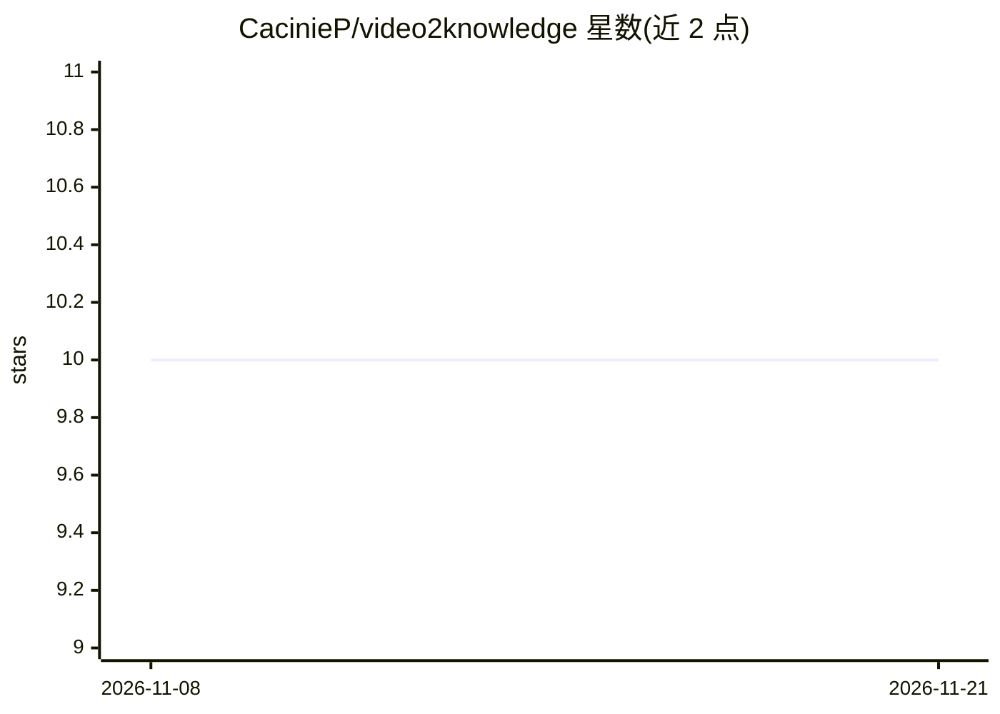

# CacinieP/video2knowledge

⭐ 10 · Python · MIT · 推送 2026-11-09 · [GitHub](https://github.com/CacinieP/video2knowledge) · 个人维护 · 中文 README

**视频转字幕/笔记/Anki 卡片的 Agent Skill，全本地处理**

以 Agent Skill 形式安装到 Claude Code、Cursor 等客户端的 skills 目录，向 agent 提供视频路径与目标后，自动在语音转写、画面理解、音画融合三种路线中选择并执行，产出带时间戳的字幕、知识文档（Markdown+HTML）、图文笔记与 Anki 卡片。默认走本地多模态模型与 Ollama，云端 ASR/文本/视觉处理需显式选择端点；也附手动 CLI 供不经 agent 直接调用。需要 Python 3.11+ 与 ffmpeg，批处理入口目前固定中文音画融合。

## 筛选速览

| 维度 | 判定 | 备注 |
|---|---|---|
| AI 角色 | `ai-native` | 本体是模型或模型工具 |
| 许可风险 | `permissive` | MIT |
| 部署形态 | `desktop` | 安装包/桌面程序 |
| 模型依赖 | local-ok | 支持本地模型 |
| 硬件要求 | — | 无带数字的原话,不猜 |
| 安装摩擦 | `medium` | 含编译或系统依赖之一 |
| 成熟度 | — | 结构信号不足 |

## 能力要点

- ASR/纯画面/音画融合三路线自动选择，按任务交付字幕、笔记、Anki 卡片
- 全本地处理链路，云端 ASR/VLM 为显式可选端点
- 可插拔 ASR 后端（faster-whisper/FunASR/云端 API/MiMo）
- 批处理支持失败续跑与 ASR 检查点复用，校验 run_manifest.json 哈希

## 适用场景

- 把课程和教程批量转成可核对来源的知识笔记
- 从无声录屏生成带关键帧的图文操作文档
- 为课程内容制作 Anki 记忆卡片

## 场景标签

`知识库管理` `语音识别` `多模态` · 领域:知识与检索

## 证据(README 行号)

> L3: 把课程、教程和录屏变成可以核对来源的笔记。安装成 **Agent Skill** 后，向 agent
> L4: 提供视频路径和目标，它会选择语音转写、画面理解或音画融合，执行并检查产物。
> L5: 默认使用本地模型；云端音频、文本和画面处理均需选择相应端点。

## 星数曲线

2026-11-08 10 → 2026-11-21 10（+0）

---
*卡片 v1 · prompt 1.4 · 生成 2026-11-20 · 置信度 mid · 依据 README sha `48f6bc99fa10` · [字段定义](../../DATASET.md)*
