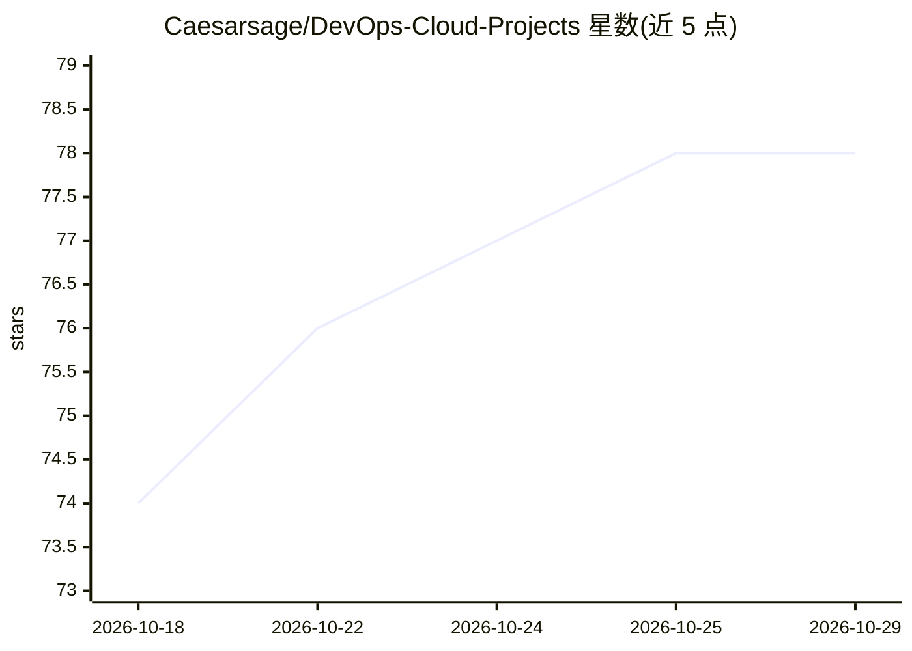

# Caesarsage/DevOps-Cloud-Projects

⭐ 78 · JavaScript · NOASSERTION · 推送 2026-07-07 · [GitHub](https://github.com/Caesarsage/DevOps-Cloud-Projects) · 个人维护

**面向工程师的 30+ 个 DevOps 实战项目清单**

策展式 DevOps 实战项目合集：按初级、中级、高级三级组织 30+ 个动手项目，每个项目含分步文档与生产级代码示例，覆盖 Linux/Web 栈、Docker、Kubernetes（含安全、服务网格、GitOps）、Terraform、Ansible、多云（AWS/Azure/GCP）、CI/CD 与负载均衡等主题。提供推荐学习路径与项目路线图，部分项目（如可观测性栈、混沌工程）标记为规划中。通过 git clone 获取，需自备 git、Docker、kubectl、Terraform 等工具。

## 筛选速览

| 维度 | 判定 | 备注 |
|---|---|---|
| AI 角色 | `ai-knowledge` | 知识聚合/清单类 |
| 许可风险 | `permissive` | NOASSERTION |
| 部署形态 | `self-host` | docker 或自建部署 |
| 模型依赖 | — | README 未给出锁定关系 |
| 硬件要求 | — | 无带数字的原话,不猜 |
| 安装摩擦 | `low` | 无编译、无系统依赖或容器化 |
| 成熟度 | — | 结构信号不足 |

## 能力要点

- 30+ 个项目按初/中/高三级组织，每项含分步文档与代码示例
- 覆盖多云（AWS/Azure/GCP）、Kubernetes 安全（RBAC、SPIFFE/SPIRE、Falco）等主题
- 提供推荐学习路径（Linux→Docker→K8s→IaC→CI/CD→GitOps）
- 列出可观测性栈、多集群联邦等规划中的项目

## 适用场景

- 按难度递进地系统学习 DevOps 工具链
- 查找 Kubernetes 安全或服务 mesh 方向的动手实验
- 为团队培训挑选端到端云原生项目

## 场景标签

`教程课程` · 领域:学习与行业

## 证据(README 行号)

> L9: **A curated collection of hands-on DevOps projects to accelerate your learning journey**
> L21: This repository contains **30+ hands-on DevOps projects** organized by difficulty level. Each project includes:
> L28: Whether you're just starting your DevOps journey or looking to level up your skills, these projects will help you g

## 星数曲线

2026-10-18 74 → 2026-10-29 78（+4）

---
*卡片 v1 · prompt 1.4 · 生成 2026-10-24 · 置信度 mid · 依据 README sha `2e2a55c6064a` · [字段定义](../../DATASET.md)*
