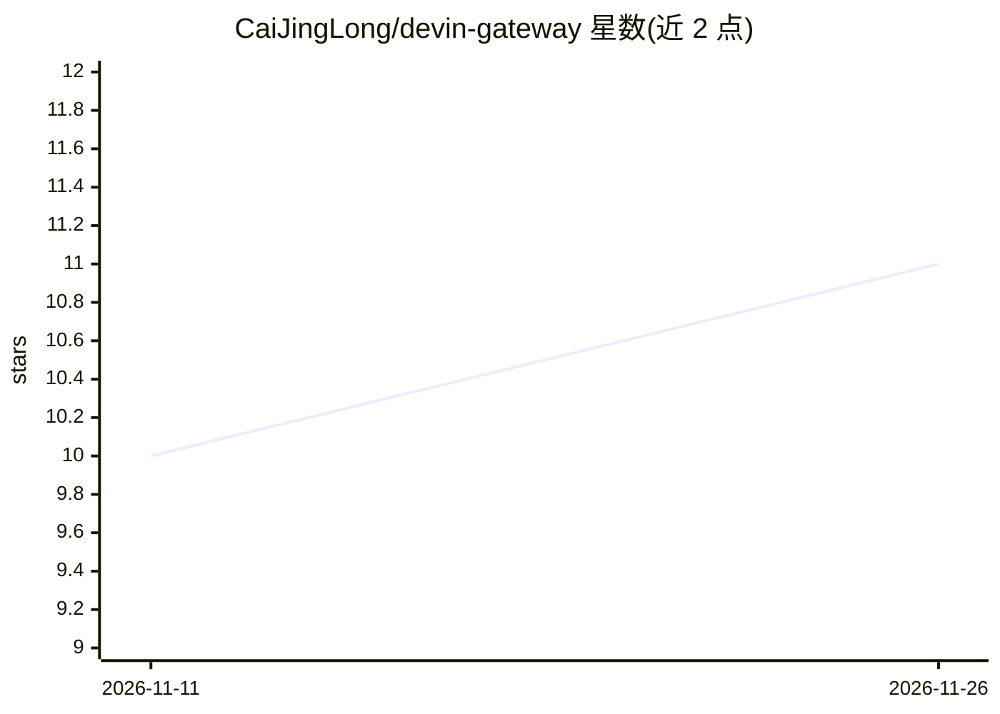

# CaiJingLong/devin-gateway

⭐ 11 · TypeScript · MIT · 推送 2026-10-15 · [GitHub](https://github.com/CaiJingLong/devin-gateway) · 个人维护 · 中文 README

**把 Devin/Windsurf Cascade 暴露为 OpenAI/Anthropic 兼容 API 的网关**

一个用 Bun 实现的轻量 API 网关：将 Devin 与 Windsurf Cascade 的接口转换为 OpenAI Chat Completions / Responses 与 Anthropic Messages 兼容端点，供 Cherry Studio 及其他兼容客户端调用，支持流式输出与模型列表。通过 OAuth 登录 CLI 获取 Devin token，按请求凭据鉴权，网关不保存 token 状态。需要有效的 Devin/Windsurf 订阅，项目自身不提供账号或额度；Protobuf 编解码在项目内实现，无第三方运行时依赖。

## 筛选速览

| 维度 | 判定 | 备注 |
|---|---|---|
| AI 角色 | `ai-ecosystem` | LLM/agent 周边工具 |
| 许可风险 | `permissive` | MIT |
| 部署形态 | `self-host` | docker 或自建部署 |
| 模型依赖 | — | README 未给出锁定关系 |
| 硬件要求 | — | 无带数字的原话,不猜 |
| 安装摩擦 | `low` | 无编译、无系统依赖或容器化 |
| 成熟度 | — | 结构信号不足 |

## 能力要点

- 提供 OpenAI Chat Completions、Responses 与 Anthropic Messages 兼容端点，支持流式
- OAuth 登录 CLI（bun run login）获取 Devin token，客户端按请求自带凭据
- 内置模型目录快照，model 字段可直接透传任意 Cascade UID
- 发布 GHCR 与 Docker Hub 的 linux/amd64、linux/arm64 镜像

## 适用场景

- 在 Cherry Studio 等客户端中通过本地端点调用 Devin 订阅内的模型
- 为支持 OpenAI/Anthropic 协议的现有客户端接入 Devin 后端
- 用 Docker 部署个人网关并按请求分发团队成员各自的 token

## 场景标签

`模型网关` · 领域:Agent 开发

## 证据(README 行号)

> L5: Expose the Devin/Windsurf Cascade API through OpenAI- and Anthropic-compatible endpoints for Cherry Studio and other
> L12: - OpenAI Chat Completions: `POST /v1/chat/completions`, with streaming support
> L45: The gateway listens on `http://localhost:3000` by default. It holds no token state — each request must carry creden

## 星数曲线

2026-11-11 10 → 2026-11-26 11（+1）

---
*卡片 v1 · prompt 1.4 · 生成 2026-11-20 · 置信度 high · 依据 README sha `2c50dd7bc6bc` · [字段定义](../../DATASET.md)*
