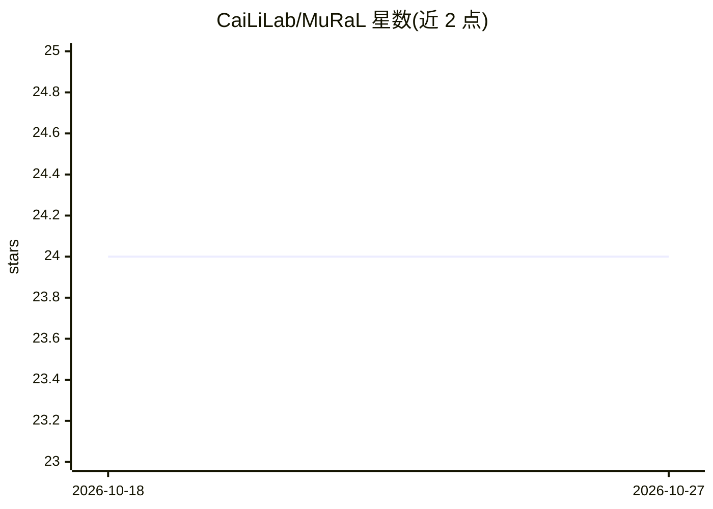

# CaiLiLab/MuRaL

⭐ 24 · Python · GPL-3.0 · 推送 2026-05-19 · [GitHub](https://github.com/CaiLiLab/MuRaL) · [官网](https://mural.readthedocs.io) · 组织维护 · 中文 README

**深度学习框架：推断基因组碱基级分辨率突变率图谱**

面向遗传学与基因组学研究的深度学习框架 MuRaL（Mutation Rate Learner），包含 MuRaL-snv 与 MuRaL-indel 两个工具，分别估计单核苷otide变异与短插入缺失的碱基分辨率突变率图谱。网络架构含局部区域与扩展区域两个信号学习模块；支持 --recurrent 标志的重复突变分析（按位点加权的损失训练）。提供四个物种（人、猕猴、拟南芥、果蝇）的预训练模型，可用于预测或迁移学习以降低数据与时间需求；安装详情指向外部文档站点。

## 筛选速览

| 维度 | 判定 | 备注 |
|---|---|---|
| AI 角色 | `ai-native` | 本体是模型或模型工具 |
| 许可风险 | `viral` | GPL-3.0 |
| 部署形态 | `None` |  |
| 模型依赖 | — | README 未给出锁定关系 |
| 硬件要求 | — | 无带数字的原话,不猜 |
| 安装摩擦 | `low` | 无编译、无系统依赖或容器化 |
| 成熟度 | — | 结构信号不足 |

## 能力要点

- MuRaL-snv 与 MuRaL-indel 分别处理 SNV 与 INDEL 突变率估计
- 支持迁移学习以降低数据与时间需求
- --recurrent 标志支持重复突变位点计数感知训练
- 提供人、猕猴、拟南芥、果蝇四个物种的预训练模型

## 适用场景

- 为非模式物种推断精细尺度的种系突变率图谱
- 利用较少测序个体生成全基因组突变率图
- 复用预训练模型做预测或迁移学习

## 场景标签

 · 领域:计算生物学/基因组学

## 证据(README 行号)

> L13: **MuRaL**, short for **Mu**tation **Ra**te **L**earner, is a generalizable deep learning framework to estimate base
> L29: Trained models for four species - ***Homo sapiens***, ***Macaca mulatta***, ***Arabidopsis thaliana*** and ***Droso

## 星数曲线

2026-10-18 24 → 2026-10-27 24（+0）

---
*卡片 v1 · prompt 1.4 · 生成 2026-10-27 · 置信度 high · 依据 README sha `795bcbaa529f` · [字段定义](../../DATASET.md)*
