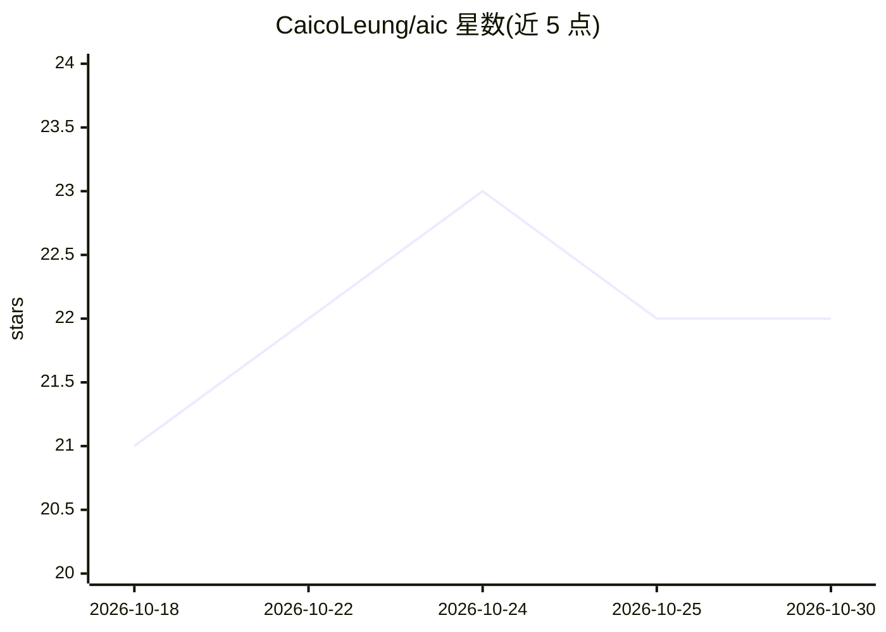

# CaicoLeung/aic

⭐ 22 · Rust · 推送 2026-10-29 · [GitHub](https://github.com/CaicoLeung/aic) · [官网](https://caicoleung.github.io/aic-web/) · 个人维护 · 中文 README

**Rust CLI：把工作区改动拆成原子提交，复用已有 AI 授权**

用 Rust 编写的命令行 git 工具：自动检测未暂存的改动，按 hunk 粒度分组并逐组生成符合 Conventional Commits v1.0.0 的提交信息。后端两种：12 个 API 提供商（OpenAI/Anthropic/Gemini/Ollama 等，需 API key），或无头模式驱动本机已登录的 CLI agent（Claude Code、Codex、opencode 等）复用其授权，无需 API key。附带合并冲突解决、一键撤销、发送前的密钥脱敏检查。面向使用 git 的开发者。

## 筛选速览

| 维度 | 判定 | 备注 |
|---|---|---|
| AI 角色 | `ai-native` | 本体是模型或模型工具 |
| 许可风险 | `permissive` | — |
| 部署形态 | `None` |  |
| 模型依赖 | local-ok | 支持本地模型 |
| 硬件要求 | — | 无带数字的原话,不猜 |
| 安装摩擦 | `medium` | 含编译或系统依赖之一 |
| 成熟度 | — | 结构信号不足 |

## 能力要点

- hunk 级原子提交：一个文件的三个改动拆成三个提交
- 无 API key：无头驱动本机已登录的 CLI agent 复用其授权
- 12 个 API 提供商可选，含 Ollama 与 OpenAI 兼容端点
- Redaction Gate：diff 含密钥特征时在发送前拒绝

## 适用场景

- 把一次写完的多个无关改动自动拆成干净的原子提交
- 不配 API key，直接复用我本机已登录的 Claude Code / Codex
- 借助 LLM 逐文件审查并完成 git 合并冲突解决

## 场景标签

 · 领域:开发者工具/git

## 证据(README 行号)

> L5: aic turns your messy working tree into a series of clean, atomic commits — powered by the AI you already have.
> L40: Run `aic` with **nothing staged** and it auto-detects every unstaged hunk, groups them by concern, and commits each
> L51: - **No API key needed** — drive the CLI agent already logged in on your machine (Claude Code, Codex, pi, opencode, 

## 星数曲线

2026-10-18 21 → 2026-10-30 22（+1）

---
*卡片 v1 · prompt 1.4 · 生成 2026-10-28 · 置信度 high · 依据 README sha `4ec2ed37ccfa` · [字段定义](../../DATASET.md)*
