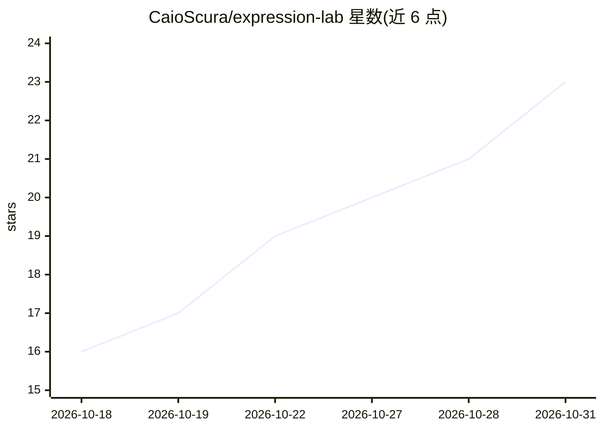

# CaioScura/expression-lab

⭐ 23 · Python · 推送 2026-10-10 · [GitHub](https://github.com/CaioScura/expression-lab) · 个人维护

**实时识别手势与面部表情并显示对应梗图的摄像头应用**

基于 Python、MediaPipe 与 OpenCV 的桌面应用：从摄像头画面检测每只手 21 个关键点、面部 478 个关键点与 52 项表情 blendshape，按角度与距离规则判定单一手势，在旁侧窗口显示预设梗图；手势需连续多帧出现才切换以防闪烁。内置 14 种手势，可经 gestos.json 与规则代码添加新手势，阈值在 config.py 集中配置。需 Python 3.12 与摄像头，MediaPipe 模型已随仓库提供，限 Windows/Linux/macOS 从源码运行。

## 筛选速览

| 维度 | 判定 | 备注 |
|---|---|---|
| AI 角色 | `ai-native` | 本体是模型或模型工具 |
| 许可风险 | `none` | — |
| 部署形态 | `library` | 以包/库形式分发 |
| 模型依赖 | — | README 未给出锁定关系 |
| 硬件要求 | — | 无带数字的原话,不猜 |
| 安装摩擦 | `low` | 无编译、无系统依赖或容器化 |
| 成熟度 | — | 结构信号不足 |

## 能力要点

- MediaPipe 手部/面部关键点与 blendshape 规则式手势判定
- 多帧确认机制防误触发，14 种内置手势
- 支持在 gestos.json 注册图像并在代码中添加自定义手势规则

## 适用场景

- 直播或视频通话中用手势触发表情包画面
- 学习 MediaPipe 关键点构建手势识别规则
- 制作基于摄像头手势的互动小工具

## 场景标签

`目标检测` · 领域:感知与多模态

## 证据(README 行号)

> L29: 1. O MediaPipe encontra os **21 pontos de cada mão** (até 2 mãos) e os **478 pontos do rosto**, além de 52 notas de
> L3: Reconhecimento de gestos e expressões faciais em tempo real pela webcam. Cada gesto reconhecido mostra um meme corre

## 星数曲线

2026-10-18 16 → 2026-10-31 23（+7）

---
*卡片 v1 · prompt 1.4 · 生成 2026-10-28 · 置信度 mid · 依据 README sha `8d0704de8726` · [字段定义](../../DATASET.md)*
