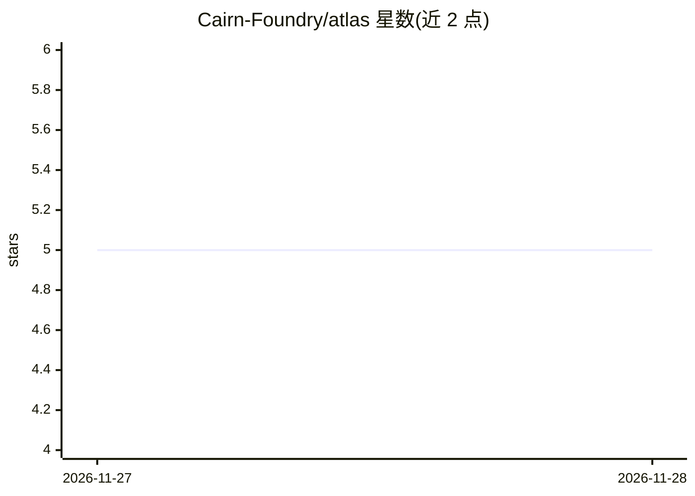

# Cairn-Foundry/atlas

⭐ 5 · Rust · AGPL-3.0 · 推送 2026-11-27 · [GitHub](https://github.com/Cairn-Foundry/atlas) · 个人维护

**给开发者编排与监督多个 Claude Code 编码 agent 的桌面工厂**

面向开发者的 Claude Code agent 编排桌面应用（Tauri）：用户把工单、merge request 或自由任务交给编排器，编排器从砖块目录（资质、计划、实现、测试、评审、修正、交付等 10 个）组装工作流，在独立 worktree 或指定分支中启动 agent，通过本地 MCP server 取任务；编排器自身不执行工作，只负责组装、跟进、重启并在需要人工时提醒。依赖 Rust 1.89+ 与已登录订阅的 Claude Code，通过 git clone 源码构建，无 web 版本，daemon 仅监听本地回环。

## 筛选速览

| 维度 | 判定 | 备注 |
|---|---|---|
| AI 角色 | `ai-ecosystem` | LLM/agent 周边工具 |
| 许可风险 | `viral` | AGPL-3.0 |
| 部署形态 | `desktop` | 安装包/桌面程序 |
| 模型依赖 | — | README 未给出锁定关系 |
| 硬件要求 | — | 无带数字的原话,不猜 |
| 安装摩擦 | `low` | 无编译、无系统依赖或容器化 |
| 成熟度 | — | 结构信号不足 |

## 能力要点

- 10 个内置砖块组成工作流，砖块目录可编辑、禁用且热加载
- 每个 agent 运行在独立 worktree，SQLite 记录每步时长与 token
- 编排器可通过对话卡片安装/修改砖块、skill 与 subagent，写入前需人工确认
- 项目级记忆：笔记在每个 agent 会话开始时注入

## 适用场景

- 把工单或 merge request 交给编排器自动走计划-实现-评审-交付流程
- 在多个仓库中并行运行带独立 worktree 的编码 agent
- 用自定义砖块和 skill 定制团队自己的 agent 工作流

## 场景标签

`多智能体` `编码 Agent` · 领域:Agent 开发

## 证据(README 行号)

> L3: A factory of Claude Code agents, supervised by an orchestrating AI and steered by the master (you).
> L9: a local MCP server. The orchestrator does not do the work: it assembles, follows, restarts, and
> L19: - Claude Code installed and signed in to your subscription (`claude`); no API key is used

## 星数曲线

2026-11-27 5 → 2026-11-28 5（+0）

---
*卡片 v1 · prompt 1.4 · 生成 2026-11-27 · 置信度 mid · 依据 README sha `159642874699` · [字段定义](../../DATASET.md)*
