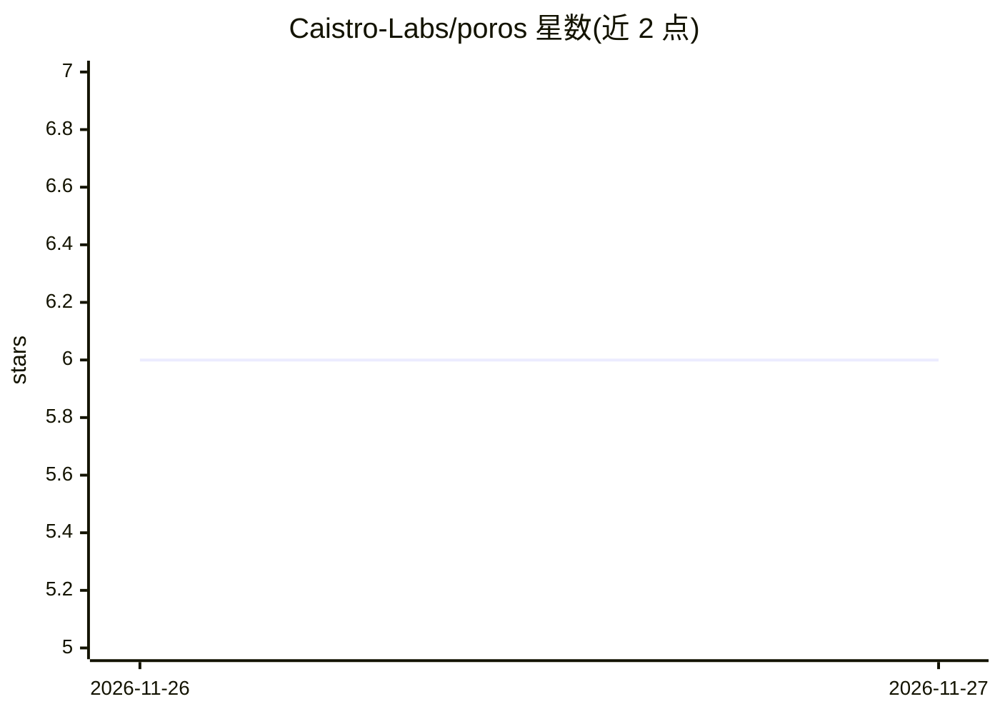

# Caistro-Labs/poros

⭐ 6 · Python · Apache-2.0 · 推送 2026-11-25 · [GitHub](https://github.com/Caistro-Labs/poros) · [官网](https://caistrolabs.com) · 组织维护

**流式 LoRA 微调引擎：在超显存模型上训练适配器**

面向超出 GPU 显存或统一内存的大模型微调引擎：将冻结的 4-bit 基座权重保存在主机内存或 SSD，逐块流式送入 GPU 训练 LoRA 适配器。支持 SFT/DPO/IPO/KTO/ORPO/SimPO，适配 Qwen、Gemma、DeepSeek-V2 等稠密与 MoE 架构，可在与常驻训练 torch.equal 一致的路径下验证结果。限制：仅单 GPU、仅 LoRA、不支持 Windows，模型本可放入显存时流式会引入额外传输开销。以 pip 包发行，提供 CLI 与 Python 训练接口。

## 筛选速览

| 维度 | 判定 | 备注 |
|---|---|---|
| AI 角色 | `ai-ecosystem` | LLM/agent 周边工具 |
| 许可风险 | `permissive` | Apache-2.0 |
| 部署形态 | `library` | 以包/库形式分发 |
| 模型依赖 | local-ok | 支持本地模型 |
| 硬件要求 | — | 无带数字的原话,不猜 |
| 安装摩擦 | `medium` | 含编译或系统依赖之一 |
| 成熟度 | — | 结构信号不足 |

## 能力要点

- 4-bit 基座权重驻留主机内存/SSD，逐层块流式经过 GPU 训练适配器
- 内置 SFT、DPO、IPO、KTO、ORPO、SimPO 六种训练方式，按数据自动选择
- 支持 MoE 专家存储到 SSD（--store ssd）与 Apple silicon（macOS 14+）
- RNG 状态快照保证 dropout 掩码一致，稠密模型可与常驻训练 torch.equal 对齐

## 适用场景

- 在 24 GB 消费级 GPU 上微调 72B 级别模型
- 在 16 GB 统一内存的 Mac 上训练大模型适配器
- 微调 MoE 模型并将专家权重放到 SSD 以节省显存
- 导出合并后的模型供 vLLM 或 TGI 部署

## 场景标签

`微调` · 领域:训练与推理

## 证据(README 行号)

> L5: **Poros** is a streaming LoRA fine-tuning engine for models larger than GPU or unified memory. It keeps frozen 4-bit
> L7: Supports SFT, DPO, IPO, KTO, ORPO, and SimPO on Linux (NVIDIA Ampere+) and Apple silicon (macOS 14+).
> L100: - **Single GPU, LoRA only:** multi-GPU and full fine-tuning are not supported yet.

## 星数曲线

2026-11-26 6 → 2026-11-27 6（+0）

---
*卡片 v1 · prompt 1.4 · 生成 2026-11-26 · 置信度 high · 依据 README sha `c0e6e324ec7d` · [字段定义](../../DATASET.md)*
