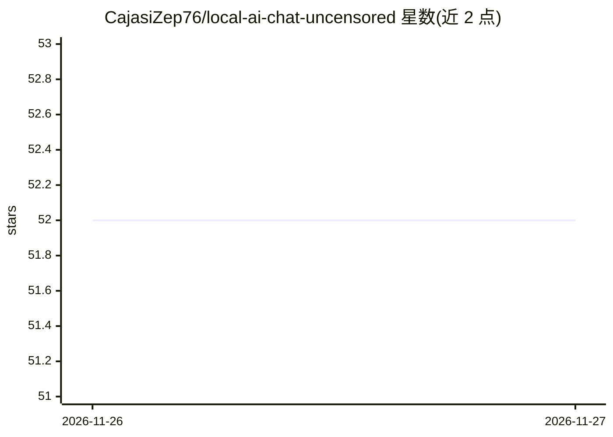

# CajasiZep76/local-ai-chat-uncensored

⭐ 52 · C++ · MIT · 推送 2026-11-24 · [GitHub](https://github.com/CajasiZep76/local-ai-chat-uncensored) · [官网](https://github.com/CajasiZep76/local-ai-chat-uncensored/releases) · 个人维护

**本地离线无过滤 LLM 聊天的 Windows 便携运行套件**

面向 Windows 10/11 x64 的本地便携 LLM 聊天运行时：下载预构建包、解压（访问码 2026）后运行安装器，通过 config/settings.json 配置，支持不重启的热重载设置。实现采用有界环形缓冲流水线、原子 JSON 状态与崩溃回滚，无编译器与外部依赖；也提供 CMake 从源码构建路径。文档含 Usage Guide、FAQ、Contributing 与 Changelog。

## 筛选速览

| 维度 | 判定 | 备注 |
|---|---|---|
| AI 角色 | `ai-native` | 本体是模型或模型工具 |
| 许可风险 | `permissive` | MIT |
| 部署形态 | `desktop` | 安装包/桌面程序 |
| 模型依赖 | — | README 未给出锁定关系 |
| 硬件要求 | — | 无带数字的原话,不猜 |
| 安装摩擦 | `medium` | 含编译或系统依赖之一 |
| 成熟度 | — | 结构信号不足 |

## 能力要点

- Windows x64 预构建便携包，无需编译器与外部依赖
- config/settings.json 热重载配置，无需重启生效
- 原子 JSON 状态机与崩溃安全回滚
- 提供 git clone + CMake 的源码构建方式

## 适用场景

- 在本机离线运行无过滤的 LLM 聊天
- 不希望数据外传的本地隐私对话
- 便携环境下即解即用的 AI 聊天工具

## 场景标签

`聊天机器人` · 领域:对话与助手

## 证据(README 行号)

> L18: **LocalAiChatUncensored — Private offline AI chat without filters** (`local-ai-chat-uncensored`) is a portable Wind
> L3:  LocalAiChatUncensored — Local Unfiltered LLM Chat with Character Presets (Hot-Reload Config, Zero Dependencies): Pr
> L26: 1. Download `local-ai-chat-uncensored-v0.1.0-win64.zip` using the download button above.

## 星数曲线

2026-11-26 52 → 2026-11-27 52（+0）

---
*卡片 v1 · prompt 1.4 · 生成 2026-11-26 · 置信度 mid · 依据 README sha `52df5c10fb8c` · [字段定义](../../DATASET.md)*
