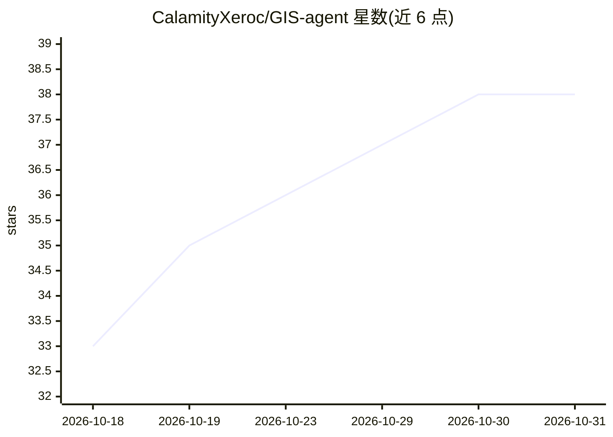

# CalamityXeroc/GIS-agent

⭐ 38 · Python · 推送 2026-10-28 · [GitHub](https://github.com/CalamityXeroc/GIS-agent) · [官网](https://www.bst-note.top/gis-agent) · 个人维护 · 中文 README

**面向 ArcGIS Pro 工作流的中文 GIS 任务智能体框架**

基于 ArcGIS Pro 3.6 与 ArcPy 构建的地理空间智能体框架：通过有界观察-决策-执行循环、原生 tool calling、代码自修复与强制验收，把自然语言指令转化为 GIS 数据扫描、处理、符号化、制图与地图导出全流程。内置 SQLite 数据目录、48 个方法论配方、制图设计引擎、图面识图验收与项目日志。默认中文交互，LLM API 为可选配置；不依赖 ArcGIS 也可启动/规划/验收，仅执行 GP 工具时需要 ArcPy。项目自述仍在早期开发阶段。

## 筛选速览

| 维度 | 判定 | 备注 |
|---|---|---|
| AI 角色 | `ai-native` | 本体是模型或模型工具 |
| 许可风险 | `none` | — |
| 部署形态 | `library` | 以包/库形式分发 |
| 模型依赖 | — | README 未给出锁定关系 |
| 硬件要求 | — | 无带数字的原话,不猜 |
| 安装摩擦 | `low` | 无编译、无系统依赖或容器化 |
| 成熟度 | — | 结构信号不足 |

## 能力要点

- 有界观察-决策-执行循环 + 原生 tool calling + 代码自修复 + 强制验收
- 48 个自带验证断言的 GIS 方法论配方，成功运行可沉淀为新配方
- 制图设计引擎自动决定纸张/图例/比例尺/配色，产出可编辑 .aprx
- 结构断言、语义核对、图面识图、交付卫生四层验收

## 适用场景

- 用中文自然语言指挥完成 GIS 数据处理与专题图制作
- 自动化 ArcGIS Pro 出图流程并自动质检交付物
- 跨任务沉淀方法论配方，固化可复用的 GIS 工作流

## 场景标签

`Agent 框架` · 领域:Agent 开发

## 证据(README 行号)

> L3: 面向 ArcGIS Pro 工作流的通用 GIS 任务求解平台脚手架。
> L7: 单一引擎：**有界观察-决策-执行循环** + 原生 tool calling + 代码自修复 + 强制验收。
> L80: **Agent 默认使用中文交互**：

## 星数曲线

2026-10-18 33 → 2026-10-31 38（+5）

---
*卡片 v1 · prompt 1.4 · 生成 2026-10-25 · 置信度 high · 依据 README sha `04182fa05de4` · [字段定义](../../DATASET.md)*
