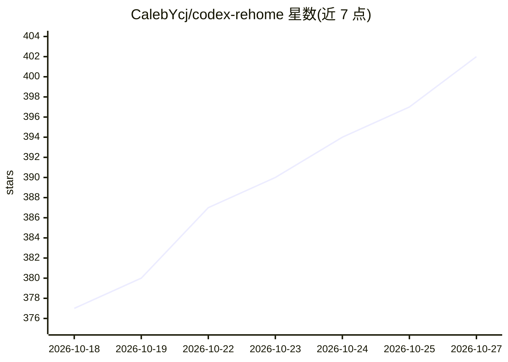

# CalebYcj/codex-rehome

⭐ 402 · Rust · MIT · 推送 2026-10-22 · [GitHub](https://github.com/CalebYcj/codex-rehome) · 个人维护 · 中文 README

**离线迁移 Codex Desktop 项目、对话与 Skills 到新电脑的桌面工具**

面向 Codex Desktop 用户的迁移工具：在原电脑选择项目、对话、Skills（.codex/skills 与 .agents/skills）、Plugins 和生成图片，生成 .rehome 迁移包，经网盘/移动硬盘等方式传到新电脑离线恢复，支持 Windows 与 macOS 四个方向及重装系统前后的备份恢复。迁移过程保持离线、不上传数据、不需管理员权限；默认排除登录令牌、Cookies、私钥等敏感内容。旧 Agent Skill 形式仍保留，适合自动化与故障处理。当前处于 Beta。

## 筛选速览

| 维度 | 判定 | 备注 |
|---|---|---|
| AI 角色 | `ai-ecosystem` | LLM/agent 周边工具 |
| 许可风险 | `permissive` | MIT |
| 部署形态 | `None` |  |
| 模型依赖 | — | README 未给出锁定关系 |
| 硬件要求 | — | 无带数字的原话,不猜 |
| 安装摩擦 | `low` | 无编译、无系统依赖或容器化 |
| 成熟度 | `idea` | |

## 能力要点

- 导出 .rehome 迁移包，离线恢复项目、对话、Skills、Plugins 与生成内容
- 支持 Windows/macOS 之间四个迁移方向
- 迁移过程离线，默认排除令牌、Cookies、私钥、.git、node_modules 等敏感内容
- 支持 .jsonl.zst 压缩会话的流式解压导出，保留原会话 ID 与格式

## 适用场景

- 换电脑时把 Codex 的项目、对话历史和 Skills 一起搬走
- 重装系统前备份 Codex 数据并在装好后恢复
- 跨 Windows 与 macOS 迁移 Codex 工作环境

## 场景标签

 · 领域:开发工具/数据迁移

## 证据(README 行号)

> L7: 把 Codex Desktop 里你选择的项目、对话、Skills、Plugins 和生成内容，从一台电脑离线搬到另一台电脑。
> L17: 1. **原电脑**：打开 ReHome Desktop，选择要带走的项目、对话和其他内容，生成一个 `.rehome` 文件。
> L19: 3. **新电脑**：先安装并登录一次 Codex，然后完全退出 Codex。打开 ReHome Desktop，导入文件并确认恢复；完成后重新打开 Codex。

## 星数曲线

2026-10-18 377 → 2026-10-27 402（+25）

---
*卡片 v1 · prompt 1.4 · 生成 2026-10-21 · 置信度 high · 依据 README sha `a21c68bccbf5` · [字段定义](../../DATASET.md)*
