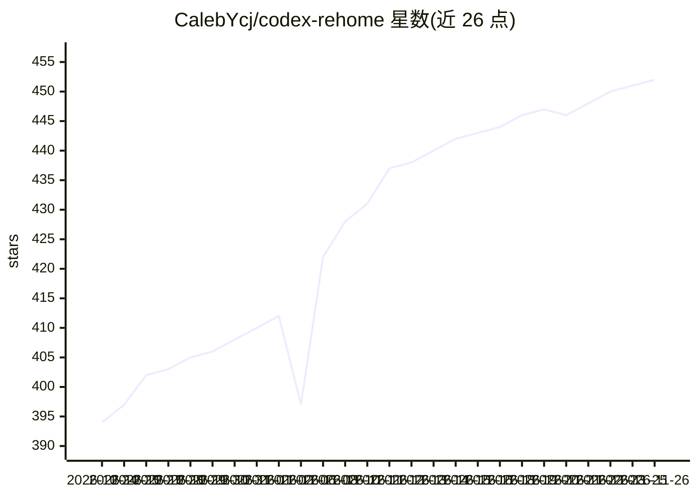

# CalebYcj/codex-rehome

⭐ 452 · Rust · MIT · 推送 2026-11-13 · [GitHub](https://github.com/CalebYcj/codex-rehome) · 个人维护 · 中文 README

**把 Codex Desktop 的项目、对话、Skills 离线迁移到另一台电脑**

为 Codex Desktop 用户提供离线数据迁移与备份工具：在原电脑选择项目、对话、Skills、Plugins 和生成内容，打包为 `.rehome` 迁移文件，经网盘/局域网/移动硬盘传输后在目标电脑导入恢复，支持 Windows 与 macOS 间四个方向的迁移。处理压缩会话解压、项目目录映射、路径改写、同名项目冲突、分叉对话依赖等边界情况；迁移默认排除令牌、私钥等敏感内容，过程离线不上传。另有保留的 Codex Agent Skill 工作流供自动化使用。

## 筛选速览

| 维度 | 判定 | 备注 |
|---|---|---|
| AI 角色 | `ai-ecosystem` | LLM/agent 周边工具 |
| 许可风险 | `permissive` | MIT |
| 部署形态 | `None` |  |
| 模型依赖 | — | README 未给出锁定关系 |
| 硬件要求 | — | 无带数字的原话,不猜 |
| 安装摩擦 | `low` | 无编译、无系统依赖或容器化 |
| 成熟度 | `idea` | |

## 能力要点

- 三步迁移：选择内容生成 `.rehome` 包、传输、在新电脑导入恢复
- 支持 Win↔mac 四个方向及重装系统前的备份恢复
- 处理 `.jsonl.zst` 压缩会话、SQLite WAL、路径改写与同名项目冲突
- 迁移保持离线，默认排除登录令牌、Cookies、私钥等敏感文件

## 适用场景

- 换电脑时带走 Codex 的项目与对话历史
- 重装系统前备份 Codex 数据并事后恢复
- 在 Windows 和 macOS 之间迁移 Codex 工作环境

## 场景标签

 · 领域:开发者工具/数据迁移

## 证据(README 行号)

> L7: 把 Codex Desktop 里你选择的项目、对话、Skills、Plugins 和生成内容，从一台电脑离线搬到另一台电脑。
> L43: - Skills（包括 `.codex/skills` 与跨 Agent 共用的 `.agents/skills`）、Plugins 和生成图片
> L82: Codex ReHome Skill 保留了原来的 Agent 工作流、脚本、Red Skill、批量自动化和故障处理能力。它适合熟悉 Codex/终端的用户；普通迁移请优先使用本仓库的 Desktop App。

## 星数曲线

2026-10-24 394 → 2026-11-26 452（+58）

---
*卡片 v1 · prompt 1.4 · 生成 2026-11-25 · 置信度 mid · 依据 README sha `334e9d3aabf7` · [字段定义](../../DATASET.md)*
