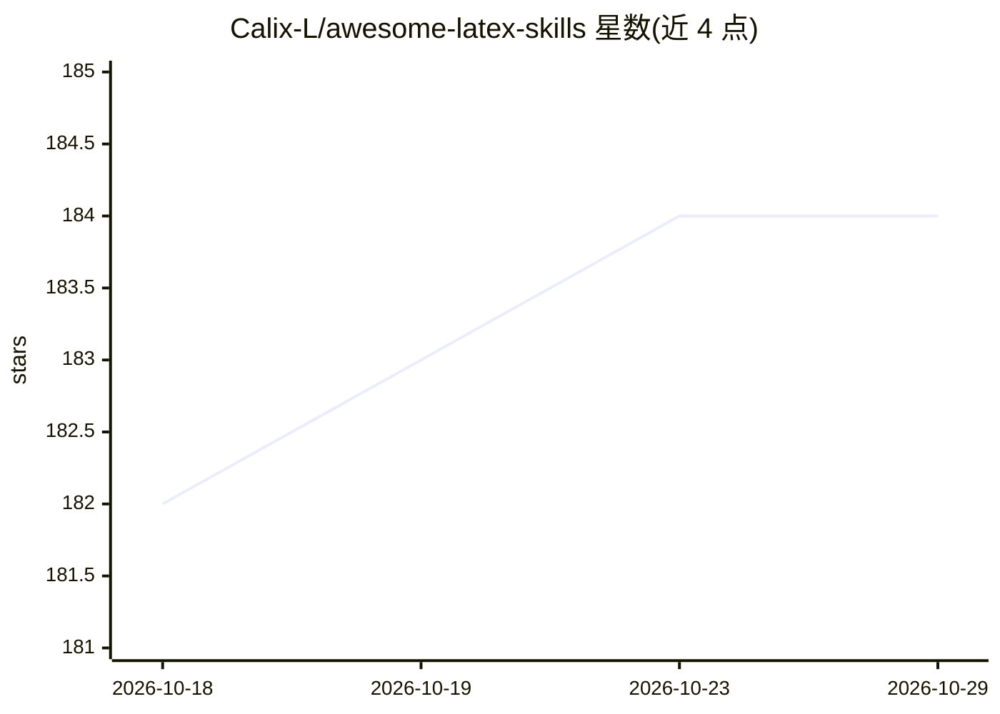

# Calix-L/awesome-latex-skills

⭐ 184 · Python · MIT · 推送 2026-10-07 · [GitHub](https://github.com/Calix-L/awesome-latex-skills) · 个人维护 · 中文 README

**面向 Claude Code/Codex 的五个 LaTeX 论文工作流 agent 技能工具包**

提供五个技能：latex-rescue 诊断并修复 LaTeX 构建错误、latex-polish 在保留论断与数字的前提下润色学术文字、latex-fmt 按会议/期刊官方要求迁移投稿模板、paper-read 将论文论断映射到证据位置、pdf2tex 从 PDF 重建可编辑 TeX 并标注不确定内容。技能通过 pip 安装后以 als install 命令装入 Claude Code 或 Codex 的技能目录，由 agent 调用执行；另提供项目诊断、可复现构建、离线变更评审（HTML 报告+校验和）与评测协议。Python 3.10+，PDF 相关功能需本地 TeX 引擎与可选依赖。

## 筛选速览

| 维度 | 判定 | 备注 |
|---|---|---|
| AI 角色 | `ai-ecosystem` | LLM/agent 周边工具 |
| 许可风险 | `permissive` | MIT |
| 部署形态 | `library` | 以包/库形式分发 |
| 模型依赖 | — | README 未给出锁定关系 |
| 硬件要求 | — | 无带数字的原话,不猜 |
| 安装摩擦 | `low` | 无编译、无系统依赖或容器化 |
| 成熟度 | — | 结构信号不足 |

## 能力要点

- 五个技能覆盖修复/润色/排版迁移/论文阅读/PDF 恢复
- 变更评审报告含源码 diff、构建证据与 SHA-256 校验和，可离线验证
- 安装器支持 dry-run、收据式更新与目录锁，不覆盖本地修改
- 覆盖 NeurIPS/ICML/Nature 等 16+ 会议期刊的官方指引路由

## 适用场景

- 论文投稿前按目标会议模板检查并迁移格式
- 修复编译失败的 LaTeX 手稿并核验修改未改动数值与论断
- 把 PDF 论文重建为可编辑 TeX 或梳理其论断-证据对应关系

## 场景标签

`提示工程` `科研工具` · 领域:Agent 开发

## 证据(README 行号)

> L7:  Five skills for LaTeX repair, academic editing, submission formatting, paper reading, and PDF recovery.
> L41: als install --agent claude
> L118: Read awesome-latex-skills/latex-rescue/SKILL.md and follow its workflow.

## 星数曲线

2026-10-18 182 → 2026-10-29 184（+2）

---
*卡片 v1 · prompt 1.4 · 生成 2026-10-22 · 置信度 high · 依据 README sha `bfb353a53263` · [字段定义](../../DATASET.md)*
