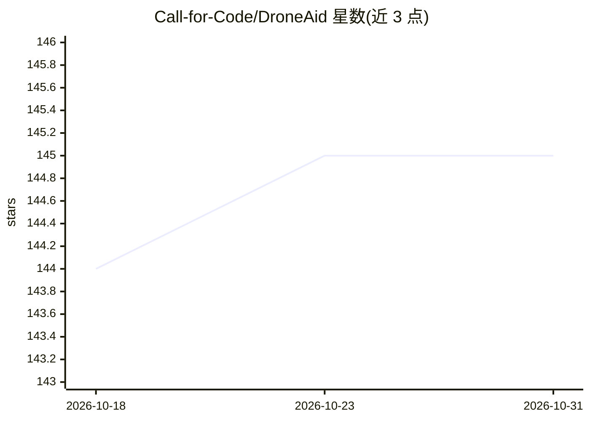

# Call-for-Code/DroneAid

⭐ 145 · HTML · Apache-2.0 · 推送 2026-06-24 · [GitHub](https://github.com/Call-for-Code/DroneAid) · 组织维护

**用视觉识别检测地面求救符号的无人机搜救系统**

面向应急救援人员的空中侦察工具：受困者用标准化 Symbol Language 符号（SOS、水、食物、庇护所等，基于 OCHA 图标）表达需求，DroneAid 用在虚拟现实中渲染符号训练的 TensorFlow.js 视觉识别模型分析无人机视频流，实时检测并统计符号，仪表盘在地图上标绘位置并启动响应。提供本地 webcam 演示（npm 安装、浏览器运行推理）与 DJI Tello 无人机完整演示，可扩展至其他无人机、飞机和卫星。

## 筛选速览

| 维度 | 判定 | 备注 |
|---|---|---|
| AI 角色 | `ai-native` | 本体是模型或模型工具 |
| 许可风险 | `permissive` | Apache-2.0 |
| 部署形态 | `library` | 以包/库形式分发 |
| 模型依赖 | — | README 未给出锁定关系 |
| 硬件要求 | — | 无带数字的原话,不猜 |
| 安装摩擦 | `medium` | 含编译或系统依赖之一 |
| 成熟度 | — | 结构信号不足 |

## 能力要点

- 基于符号语言的预训练视觉识别模型，浏览器端 TensorFlow.js 推理
- 实时检测并统计 SOS/水/食物/庇护所等 8 类符号并给出置信度
- 无需无人机的本地 webcam 演示（npm install + npm run demo）
- 支持 DJI Tello 视频流实时分析，可扩展至其他飞行器与卫星

## 适用场景

- 灾后传统通信中断时，通过无人机识别地面求救符号定位需求
- 用电脑摄像头本地测试符号检测模型
- 在地图仪表盘上查看检测到的需求位置并安排响应

## 场景标签

`目标检测` · 领域:感知与多模态

## 证据(README 行号)

> L5: DroneAid uses machine learning to detect calls for help on the ground placed by those in need. At the heart of Drone
> L13: 3. The trained model that can be applied to drone livestream video

## 星数曲线

2026-10-18 144 → 2026-10-31 145（+1）

---
*卡片 v1 · prompt 1.4 · 生成 2026-10-22 · 置信度 high · 依据 README sha `a0fe8ad3e3c5` · [字段定义](../../DATASET.md)*
