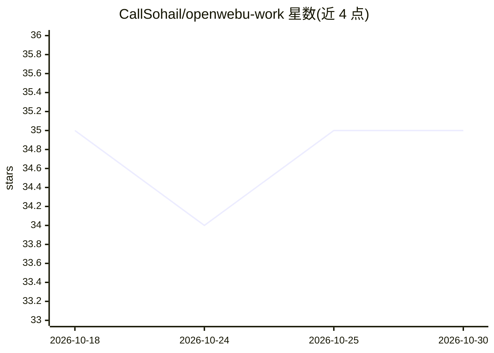

# CallSohail/openwebu-work

⭐ 35 · Python · MIT · 推送 2026-09-25 · [GitHub](https://github.com/CallSohail/openwebu-work) · [官网](https://openwebui.com/u/callsohail_) · 个人维护

**面向 Open WebUI 的可复用扩展集合：工具、过滤器、管道、动作与事件**

为 Open WebUI 服务器组织的扩展合集，覆盖 Tool/Filter/Pipe/Action/Event 五类插件 API。收录 Rich Email Composer（富 UI 邮件起草）、Study Mode（苏格拉底式导学过滤器）、Quick Actions（消息级快捷动作）、Secure Dynamic Onboarding（多语言权限感知引导事件）与 RAGFlow Advanced Connector（RAGFlow 检索接入）五个扩展，各自独立语义化版本并附专属 README。扩展通过 Workspace > Tools 或 Admin Panel > Functions 导入，以 Python 在服务器端执行；仓库要求不含密钥与部署私有信息。部分扩展声明需 Open WebUI 0.11.1/0.11.3 以上版本。

## 筛选速览

| 维度 | 判定 | 备注 |
|---|---|---|
| AI 角色 | `ai-ecosystem` | LLM/agent 周边工具 |
| 许可风险 | `permissive` | MIT |
| 部署形态 | `None` |  |
| 模型依赖 | — | README 未给出锁定关系 |
| 硬件要求 | — | 无带数字的原话,不猜 |
| 安装摩擦 | `low` | 无编译、无系统依赖或容器化 |
| 成熟度 | — | 结构信号不足 |

## 能力要点

- 覆盖 Open WebUI 五类插件 API（Tool/Filter/Pipe/Action/Event）
- 五个扩展独立语义化版本，各自带专属 README 与安装步骤
- RAGFlow Advanced Connector 提供 RAGFlow 检索、数据集发现与文档搜索
- 明确安全策略：凭据放 Valves/环境配置，扩展视为可信服务器端代码

## 适用场景

- 在 Open WebUI 中添加邮件起草、学习辅导等交互功能
- 通过 Filter/Event 拦截请求、控制系统引导流程
- 将 RAGFlow 检索能力接入 Open WebUI 对话

## 场景标签

`RAG` · 领域:知识与检索

## 证据(README 行号)

> L3: A structured collection of reusable Open WebUI Tools and Functions.
> L28: - **Tool**: gives a model a callable capability, such as an API or data source.
> L30: - **Pipe**: exposes a custom model, provider, router, or full workflow.

## 星数曲线

2026-10-18 35 → 2026-10-30 35（+0）

---
*卡片 v1 · prompt 1.4 · 生成 2026-10-25 · 置信度 high · 依据 README sha `ebd02b66fb49` · [字段定义](../../DATASET.md)*
