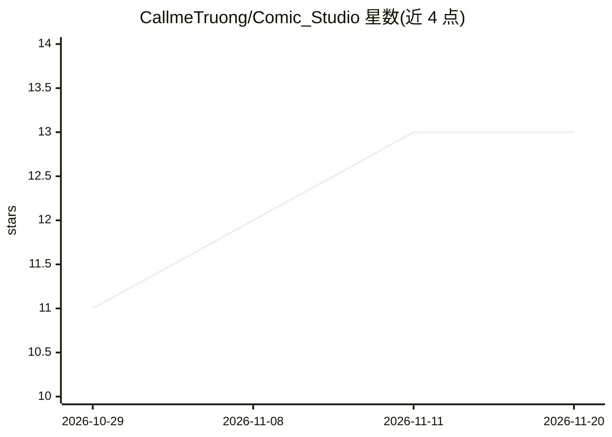

# CallmeTruong/Comic_Studio

⭐ 13 · Python · 推送 2026-11-10 · [GitHub](https://github.com/CallmeTruong/Comic_Studio) · 个人维护

**基于 LangGraph 与本地 Stable Diffusion 的自主漫画生成 agent**

ComicStudio 将一个创意转化为可编辑的漫画页：agent 工作流依次完成故事规划、英文/越南语对白撰写、分镜校验、本地 Stable Diffusion 1.5 渲染、页面排版与气泡添加，再由视觉模型做 QA 并按校正回路重渲染（默认最多 3 次重试）。用户可在 UI 中调整采样参数、选择 LoRA 与布局，并逐格重生成。渲染推荐 NVIDIA GPU 的 CUDA PyTorch 构建，规划与 QA 需外部 OpenAI 兼容端点；模型权重需手动下载放置。

## 筛选速览

| 维度 | 判定 | 备注 |
|---|---|---|
| AI 角色 | `ai-native` | 本体是模型或模型工具 |
| 许可风险 | `none` | — |
| 部署形态 | `None` |  |
| 模型依赖 | — | README 未给出锁定关系 |
| 硬件要求 | — | 无带数字的原话,不猜 |
| 安装摩擦 | `medium` | 含编译或系统依赖之一 |
| 成熟度 | — | 结构信号不足 |

## 能力要点

- LangGraph 编排的六节点 agent 工作流，含视觉 QA 与定向重试回路
- 本地运行 Stable Diffusion 1.5，支持 LoRA 与可选负向 embedding
- Compel 长提示词分块与权重化，避免截断
- 逐格提示词/对白编辑、历史页面与实时进度流

## 适用场景

- 从一个创意一键生成四格/多格漫画页
- 本地渲染并手动调整分镜参数与 LoRA 风格
- 逐格修改提示词或对白而不重跑整页

## 场景标签

`图像生成` · 领域:内容生成

## 证据(README 行号)

> L3: > An autonomous AI agent acting as a complete virtual comic studio. It integrates with a lightweight, locally runnin
> L9: ComicStudio turns a short idea into an editable comic page through agent-led story planning, local panel generation,
> L25: |**AI panel rendering**|Generates each panel locally with Stable Diffusion 1.5 and an optional SD 1.5 LoRA.|

## 星数曲线

2026-10-29 11 → 2026-11-20 13（+2）

---
*卡片 v1 · prompt 1.4 · 生成 2026-11-18 · 置信度 high · 依据 README sha `34a7a6274daf` · [字段定义](../../DATASET.md)*
