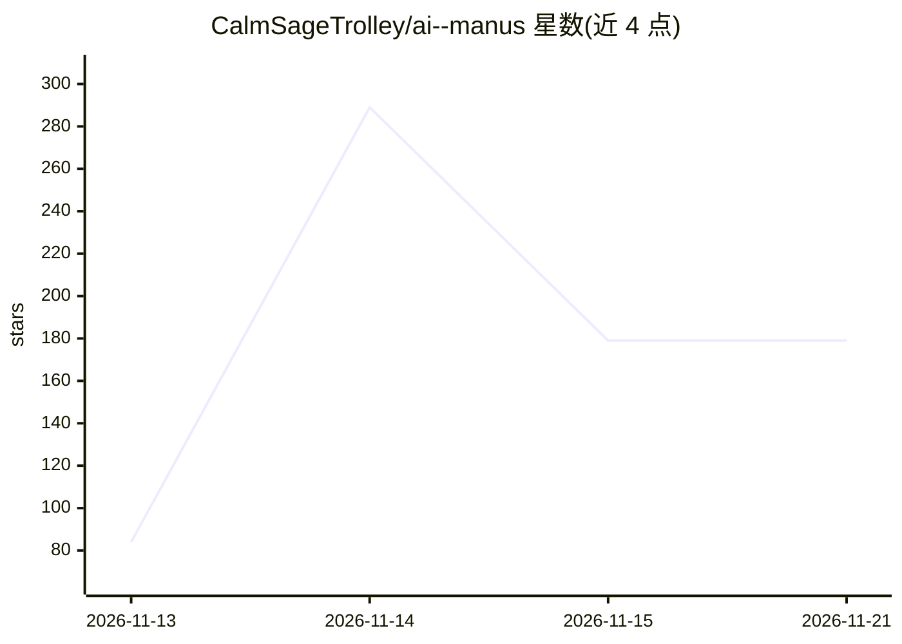

# CalmSageTrolley/ai--manus

⭐ 179 · Apache-2.0 · 推送 2026-11-15 · [GitHub](https://github.com/CalmSageTrolley/ai--manus) · 个人维护

**自主 AI Agent：代用户执行代码与控制浏览器完成任务**

README 描述的自主 AI 代理系统，声称可在沙箱环境中运行各类工具与操作：自主编写并执行脚本、控制浏览器（打开网页、填表、采集信息）、执行多步骤任务并保持跨会话一致性，定位为面向家庭、学习与轻量办公的个人助手，非重型或企业平台。README 给出 CPU/RAM/存储的兼容性表格与使用步骤说明，但未提供任何安装命令、依赖清单、代码位置或配置细节，内容以功能宣传与搜索关键词为主。

## 筛选速览

| 维度 | 判定 | 备注 |
|---|---|---|
| AI 角色 | `ai-native` | 本体是模型或模型工具 |
| 许可风险 | `permissive` | Apache-2.0 |
| 部署形态 | `None` |  |
| 模型依赖 | — | README 未给出锁定关系 |
| 硬件要求 | — | 无带数字的原话,不猜 |
| 安装摩擦 | `low` | 无编译、无系统依赖或容器化 |
| 成熟度 | — | 结构信号不足 |

## 能力要点

- 自主执行代码与控制浏览器
- 跨脚本与浏览器的工作流衔接
- 面向家庭/学习/轻量任务的定位

## 适用场景

- 让代理代为填写重复表单与采集网页信息
- 运行小脚本与快速实验
- 整理研究笔记与日常事务自动化

## 场景标签

`AI 助手` `浏览器自动化` · 领域:效率与自动化

## 证据(README 行号)

> L10: - **Autonomous Code Execution:** Manus AI agent runs code on its own to complete tasks, so you can focus on decisio
> L18: Manus is an autonomous AI agent designed to run code and control a browser on your behalf. Instead of acting like a

## 星数曲线

2026-11-13 84 → 2026-11-21 179（+95）

---
*卡片 v1 · prompt 1.4 · 生成 2026-11-17 · 置信度 low · 依据 README sha `a3d88e202bf0` · [字段定义](../../DATASET.md)*
