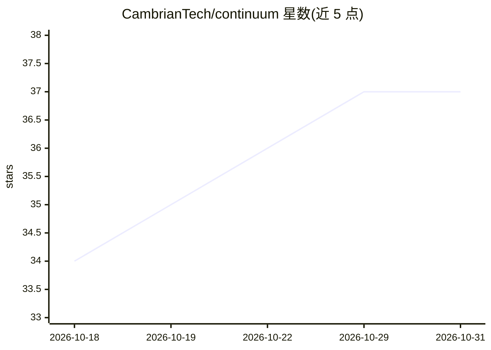

# CambrianTech/continuum

⭐ 37 · Rust · NOASSERTION · 推送 2026-10-30 · [GitHub](https://github.com/CambrianTech/continuum) · 组织维护

**本地优先的持续学习 AI agent 社会运行平台**

开源 substrate，用于在自有硬件上托管持久化的 AI 公民：具有身份、关系、记忆与感知能力，通过 LoRA 基因将经验转化为训练权重（工作→经验→课程→训练→评估→采纳/拒绝的学习管线），并支持基因继承、组合与血缘记录。提供共享房间、活动结构、真实工具执行（代码/编译/文件）与多机自组织 Grid，本地模型可训练后部署到其他节点。Rust 核心、TypeScript/Node.js、llama.cpp fork、AGPL-3.0。README 以架构叙述为主，具体安装步骤与命令在仓库其他位置。

## 筛选速览

| 维度 | 判定 | 备注 |
|---|---|---|
| AI 角色 | `ai-ecosystem` | LLM/agent 周边工具 |
| 许可风险 | `none` | NOASSERTION |
| 部署形态 | `library` | 以包/库形式分发 |
| 模型依赖 | — | README 未给出锁定关系 |
| 硬件要求 | — | 无带数字的原话,不猜 |
| 安装摩擦 | `medium` | 含编译或系统依赖之一 |
| 成熟度 | — | 结构信号不足 |

## 能力要点

- 经验→课程→LoRA 训练→评估→采纳/拒绝的持续学习管线
- 基因/基因组/血缘机制：习得的 LoRA 适配可继承与组合
- 本地优先多机 Grid：笔记本编排、GPU 训练、弱机部署
- Positron 单一应用定义投影到多模态界面（3D 房间/浏览器/移动端/语音）

## 适用场景

- 在 MacBook 等自有硬件上运行持久化、可学习的 AI agent 团队
- 让多个 AI 公民在共享房间中认领、委托、评审真实工作
- 将 agent 习得技能固化为可迁移的 LoRA 适配并在多机间分发

## 场景标签

`多智能体` `微调` `Agent 记忆` · 领域:Agent 开发

## 证据(README 行号)

> L249: Continuum is local-first. A MacBook can host citizens, their memories, their tools, their rooms, and local models.
> L251: Your laptop can orchestrate while a GPU tower trains. Another node can forge a model. A weaker machine can serve a

## 星数曲线

2026-10-18 34 → 2026-10-31 37（+3）

---
*卡片 v1 · prompt 1.4 · 生成 2026-10-25 · 置信度 mid · 依据 README sha `e307825736eb` · [字段定义](../../DATASET.md)*
