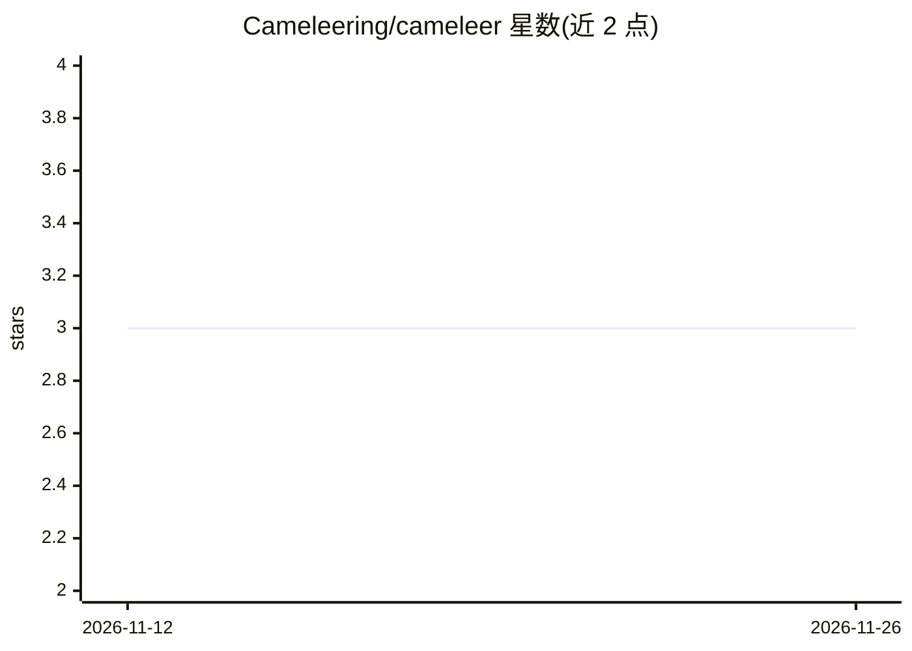

# Cameleering/cameleer

⭐ 3 · Rust · Apache-2.0 · 推送 2026-11-25 · [GitHub](https://github.com/Cameleering/cameleer) · [官网](https://cameleer.ing) · 组织维护

**为 AI Agent 提供 Rust 实现的可靠动作层：路由即 MCP 工具**

用 Rust 重建 Apache Camel 的集成模型：端点 URI、企业集成模式、YAML/XML 路由与错误处理均沿用，含约 230 个组件，仅依赖 Rust 标准库，发布为单一原生二进制。面向 AI Agent 场景，路由可经一条命令作为 MCP 工具对外提供，每次调用经过 JSON Schema 校验、幂等、人工审批、超时取消、补偿与哈希链审计日志。Apache-2.0 许可，支持 Docker 运行，项目自述不包含 Camel 源码、与 ASF 无隶属关系。

## 筛选速览

| 维度 | 判定 | 备注 |
|---|---|---|
| AI 角色 | `ai-ecosystem` | LLM/agent 周边工具 |
| 许可风险 | `permissive` | Apache-2.0 |
| 部署形态 | `self-host` | docker 或自建部署 |
| 模型依赖 | — | README 未给出锁定关系 |
| 硬件要求 | — | 无带数字的原话,不猜 |
| 安装摩擦 | `low` | 无编译、无系统依赖或容器化 |
| 成熟度 | `idea` | |

## 能力要点

- 路由作为 MCP 工具一键暴露（--mcp / --mcp-stdio），兼作 MCP 客户端与网关
- 调用封装含校验、幂等、审批、熔断、补偿与哈希链审计记录
- 约 230 个组件，无 JVM、无 GC、无第三方依赖树
- 支持 Intel TDX / AMD SEV-SNP 机密 VM 内返回路由与工具的硬件证据（自述尚未在真实 TEE 硬件上运行）

## 适用场景

- 把 Kafka、SQS、MQTT、webhook 等事件接入模型调用
- 让 Agent 的工具调用具备审批、幂等与审计保障
- 以 Camel YAML 迁移既有集成路由到 Rust 运行时
- 作为 sidecar 或库嵌入 Agent 应用执行具体动作

## 场景标签

`Agent 框架` `工作流自动化` · 领域:Agent 开发

## 证据(README 行号)

> L18: - **Act reliably.** An agent decides; a route does it. Serve routes as MCP tools with one
> L170: **The model decides *what*; a tested route decides *how*.** Cameleer feeds events to models,
> L182: `camel.server.mcp-enabled=true` in the Rust crate. Cameleer is both an MCP server and an MCP

## 星数曲线

2026-11-12 3 → 2026-11-26 3（+0）

---
*卡片 v1 · prompt 1.4 · 生成 2026-11-22 · 置信度 high · 依据 README sha `0dfac526bd51` · [字段定义](../../DATASET.md)*
