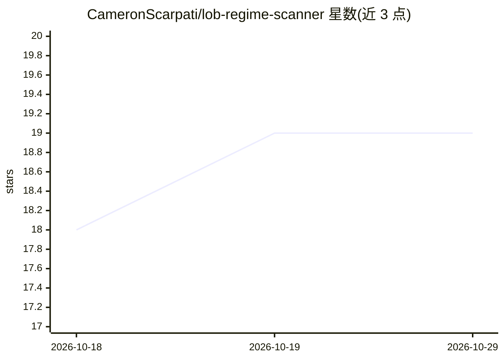

# CameronScarpati/lob-regime-scanner

⭐ 19 · Python · MIT · 推送 2026-09-29 · [GitHub](https://github.com/CameronScarpati/lob-regime-scanner) · 个人维护

**加密货币订单簿 HMM 状态识别管线与可视化仪表盘**

学习性质项目：从 Tardis.dev 的 L2 快照数据计算 36 个微观结构候选特征（OFI、VPIN、Kyle's λ、波动率、自相关等），选 8 个喂入三状态高斯隐马尔可夫模型（Baum-Welch EM 拟合、前向算法因果解码），输出 Quiet/Trending/Toxic 状态标注，并在四面板 Plotly Dash 仪表盘中展示热力图、状态概率、3D 深度曲面与毒性诊断。附带回测与笔记本，含可选 C++ pybind11 订单簿引擎。作者明确声明未在真实市场数据上验证，非生产交易信号。

## 筛选速览

| 维度 | 判定 | 备注 |
|---|---|---|
| AI 角色 | `ai-native` | 本体是模型或模型工具 |
| 许可风险 | `permissive` | MIT |
| 部署形态 | `None` |  |
| 模型依赖 | — | README 未给出锁定关系 |
| 硬件要求 | — | 无带数字的原话,不猜 |
| 安装摩擦 | `medium` | 含编译或系统依赖之一 |
| 成熟度 | `idea` | |

## 能力要点

- 36 个候选微观结构特征（OFI/VPIN/Kyle's λ 等），精选 8 个输入高斯 HMM
- 三状态因果解码（前向算法），前 70% 训练、后 30% 样本外回测
- 四面板 Plotly Dash 交互仪表盘（热力图/状态概率/3D 深度/毒性诊断）
- 可选 C++17 pybind11 订单簿重建引擎（含 make bench 基准）

## 适用场景

- 学习 HMM 在限价订单簿数据上的状态识别方法
- 探索订单流与流动性特征的分布和相关性
- 可视化查看订单簿状态随时间的演化

## 场景标签

`金融量化` · 领域:学习与行业

## 证据(README 行号)

> L3: ### Hidden Markov Model Regime Detection for Cryptocurrency Order Books
> L24: Tardis L2 Snapshots ──▸ 36 Candidate Features (8 fitted) ──▸ Gaussian HMM ──▸ Regime Detection ──▸ Dashboard

## 星数曲线

2026-10-18 18 → 2026-10-29 19（+1）

---
*卡片 v1 · prompt 1.4 · 生成 2026-10-29 · 置信度 high · 依据 README sha `4a3a7b962c27` · [字段定义](../../DATASET.md)*
