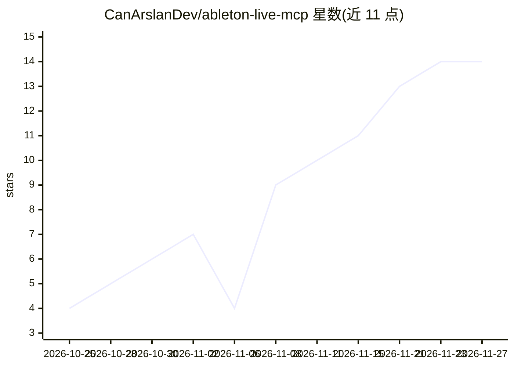

# CanArslanDev/ableton-live-mcp

⭐ 14 · Python · MIT · 推送 2026-11-26 · [GitHub](https://github.com/CanArslanDev/ableton-live-mcp) · 个人维护

**让 AI 助手通过 MCP 全面控制 Ableton Live 的服务器**

由 MCP 服务器与 Ableton Live Remote Script 组成，通过通用桥接暴露完整 Live Object Model，默认配置含 77 个工具（full 配置 109 个），并附音乐理论生成器与音频分析工具。基于 ahujasid/ableton-mcp 的 fork，新增约 40 个工具与工作流 prompt。支持 Live 11/12、Python 3.10+，MIT 许可；MusicGen 模型权重为 CC-BY-NC 4.0，限非商业用途。

## 筛选速览

| 维度 | 判定 | 备注 |
|---|---|---|
| AI 角色 | `ai-ecosystem` | LLM/agent 周边工具 |
| 许可风险 | `permissive` | MIT |
| 部署形态 | `desktop` | 安装包/桌面程序 |
| 模型依赖 | — | README 未给出锁定关系 |
| 硬件要求 | — | 无带数字的原话,不猜 |
| 安装摩擦 | `low` | 无编译、无系统依赖或容器化 |
| 成熟度 | — | 结构信号不足 |

## 能力要点

- 通用 LOM 桥接：lom_get_object/lom_set_property/lom_call_method 可达 Max for Live 能及的对象
- 内置生成器：和弦进行、鼓型、贝斯线、琶音、旋律、欧几里得节奏及 24 种土耳其 makam
- 音频分析：measure_levels、render_and_analyze、mix_doctor 遮蔽诊断、compare_to_reference
- 机器学习工具：Demucs 分离 stems、Basic Pitch 音频转 MIDI、CLAP 相似声音搜索、MusicGen 文本生成音频

## 适用场景

- 用自然语言让 AI 助手操作 Live 的轨道、设备、clip 与编排
- 生成和弦进行、鼓型、旋律并写入 clip
- 对工程做混音诊断：响度、遮蔽、相位、与参考曲目对比
- 用 Demucs 分离 stems、Basic Pitch 把旋律转成 MIDI clip

## 场景标签

 · 领域:音乐制作/AI 助手工具

## 证据(README 行号)

> L3: **Give an AI assistant the whole of Ableton Live, not just a handful of commands.**
> L5: An MCP server and Live Remote Script that expose the complete Live Object Model,
> L13: Built on ahujasid/ableton-mcp (MIT),

## 星数曲线

2026-10-25 4 → 2026-11-27 14（+10）

---
*卡片 v1 · prompt 1.4 · 生成 2026-11-19 · 置信度 high · 依据 README sha `ef56834d02dc` · [字段定义](../../DATASET.md)*
