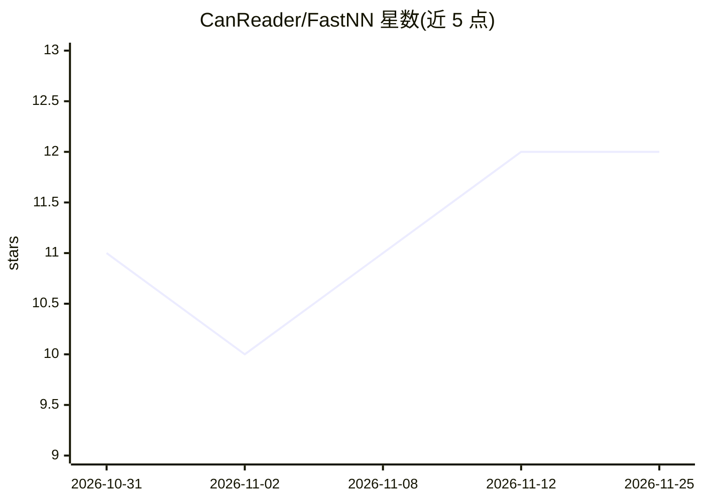

# CanReader/FastNN

⭐ 12 · Rust · MIT · 推送 2026-11-23 · [GitHub](https://github.com/CanReader/FastNN) · 个人维护

**为 Rust 开发者提供内置 CUDA 加速的神经网络训练库**

FastNN 是一个以 Rust 编写、单 crate 交付的深度学习库：提供带自动微分的张量、MLP/CNN/RNN/transformer 所需的层与优化器、数据加载及可恢复训练的 checkpoint。CPU 构建仅需 cargo，启用 cuda feature 后编译仓库内 kernel 并经 cuBLAS 执行 matmul（Turing 至 Hopper，compute capability 7.5–9.0）。计算仅支持 f32，版本 0.x API 可能变动；LSTM/GRU 由普通 op 逐门逐时间步构建，适合短序列。

## 筛选速览

| 维度 | 判定 | 备注 |
|---|---|---|
| AI 角色 | `ai-native` | 本体是模型或模型工具 |
| 许可风险 | `permissive` | MIT |
| 部署形态 | `library` | 以包/库形式分发 |
| 模型依赖 | — | README 未给出锁定关系 |
| 硬件要求 | `cpu-ok` | |
| 安装摩擦 | `medium` | 含编译或系统依赖之一 |
| 成熟度 | `idea` | |

## 能力要点

- 无 tape 的反向模式 autograd：删除 loss 即释放计算图
- 一个 feature flag 启用 CUDA kernel，matmul 路由经 cuBLAS
- transformer 端到端支持：多头注意力、KV cache、温度/top-k/top-p/beam search
- Safetensors 读写 checkpoint，携带优化器状态与步数供恢复训练

## 适用场景

- 用 Rust 从零训练 MLP/CNN 等神经网络
- 训练小型 GPT 字符语言模型
- 在 NVIDIA GPU 上运行训练循环

## 场景标签

`模型训练` · 领域:训练与推理

## 证据(README 行号)

> L13: FastNN trains neural networks in Rust. It has tensors with automatic
> L35: - **GPU with one flag.** `--features cuda` compiles the kernels in this
> L146: |Layers|`Linear`, `Conv1d`, `Conv2d` (dilation, groups, depthwise), `ConvTranspose1d/2d`, pooling, `BatchNorm2d`, 

## 星数曲线

2026-10-31 11 → 2026-11-25 12（+1）

---
*卡片 v1 · prompt 1.4 · 生成 2026-11-18 · 置信度 high · 依据 README sha `70c92382836e` · [字段定义](../../DATASET.md)*
