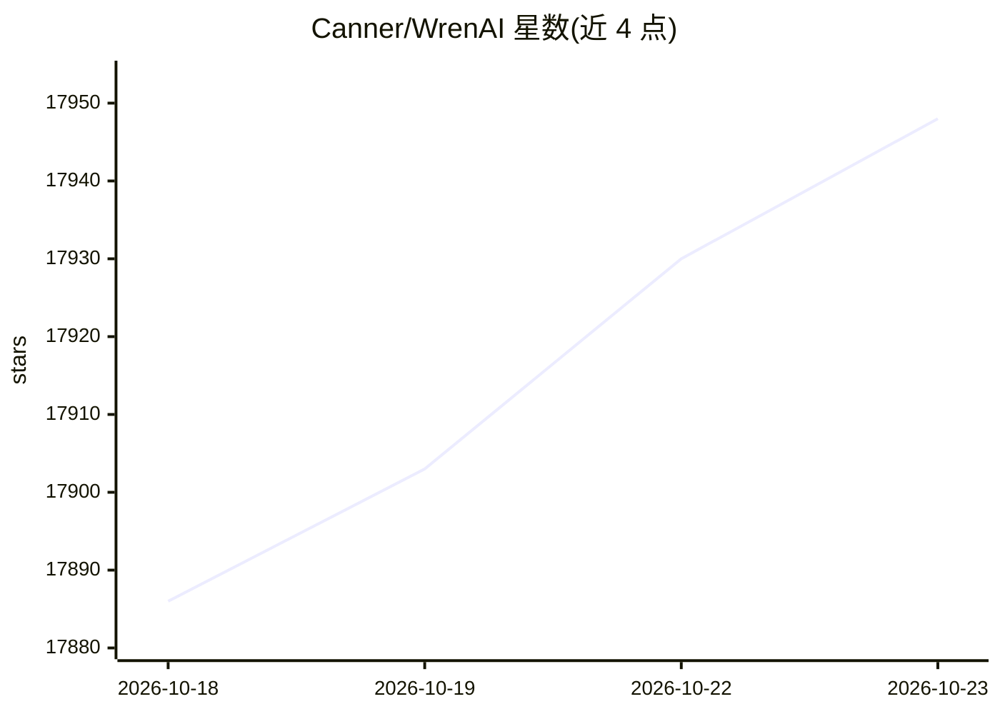

# Canner/WrenAI

⭐ 17,948 · Python · NOASSERTION · 推送 2026-10-22 · [GitHub](https://github.com/Canner/WrenAI) · [官网](https://www.getwren.ai/en/open-core) · 组织维护 · 中文 README

**给 AI agent 提供受治理 text-to-SQL 与语义层的开源 GenBI 引擎**

以 CLI（pip 安装）与 SDK 形式提供的开源 GenBI 引擎：用 MDL 建模语言将指标定义、枚举、连接关系等业务语义以 YAML/Markdown 文件托管在 Git 中，为已有 agent（Claude Code、Cursor、MCP 客户端等）提供语义层与上下文层，把自然语言问题转成经 dry-plan 校验的 SQL 并可部署为可分享的 dashboard。核心引擎、SDK 与 skills 为 Apache-2.0 且可自托管；行列级安全、GenBI UI、Agentic Mode 等属商业版 Wren AI Cloud / Enterprise Plus。旧 Docker 版 GenBI 应用已归档至 legacy/v1 分支，无新特性与安全修复。

## 筛选速览

| 维度 | 判定 | 备注 |
|---|---|---|
| AI 角色 | `ai-ecosystem` | LLM/agent 周边工具 |
| 许可风险 | `dual` | NOASSERTION |
| 部署形态 | `library` | 以包/库形式分发 |
| 模型依赖 | — | README 未给出锁定关系 |
| 硬件要求 | — | 无带数字的原话,不猜 |
| 安装摩擦 | `low` | 无编译、无系统依赖或容器化 |
| 成熟度 | — | 结构信号不足 |

## 动量与使用信号

- 维护:`active` — 距上次 push 1.9 天,年发版 68,86 位贡献者
- 涨星:近 1 天 **+9**(自 20261016 起算)
- 安装:npm 包 `skills` 月下载 23,786,800
- 平台:— · 协议:MCP

## 能力要点

- MDL 语义层与 AI 上下文层以可审查的 YAML/Markdown 文件存于 Git
- 覆盖 22+ 数据源（BigQuery、Snowflake、PostgreSQL、ClickHouse 等）的治理式执行
- 提供 wren-langchain、wren-pydantic 等 Agent SDK 与 MCP server
- agent 构建的浏览器端 dashboard 可部署到 Vercel 或 Cloudflare Pages

## 适用场景

- 让 agent 基于公司统一的指标定义生成可信 SQL
- 把业务语义作为版本化文件纳入 PR 审查流程
- 用自然语言问答生成可分享的 BI dashboard
- 自托管或离线环境中部署 GenBI 能力

## 场景标签

`数据分析` · 领域:效率与自动化

## 证据(README 行号)

> L24: WrenAI is the open-source **generative BI (GenBI) engine**. It gives the AI agents you already use (Claude Code, Cu
> L147: - **Engine**: Apache DataFusion based. BigQuery, Snowflake, PostgreSQL, ClickHouse, Amazon Redshift, Databricks, D
> L150: - **Agent SDKs**: `wren-langchain` (LangChain / LangGraph), `wren-pydantic`, and a reference Python integration fo

## 星数曲线

2026-10-18 17,886 → 2026-10-23 17,948（+62）

---
*卡片 v1 · prompt 1.4 · 生成 2026-10-18 · 置信度 high · 依据 README sha `3f159500deef` · [字段定义](../../DATASET.md)*
