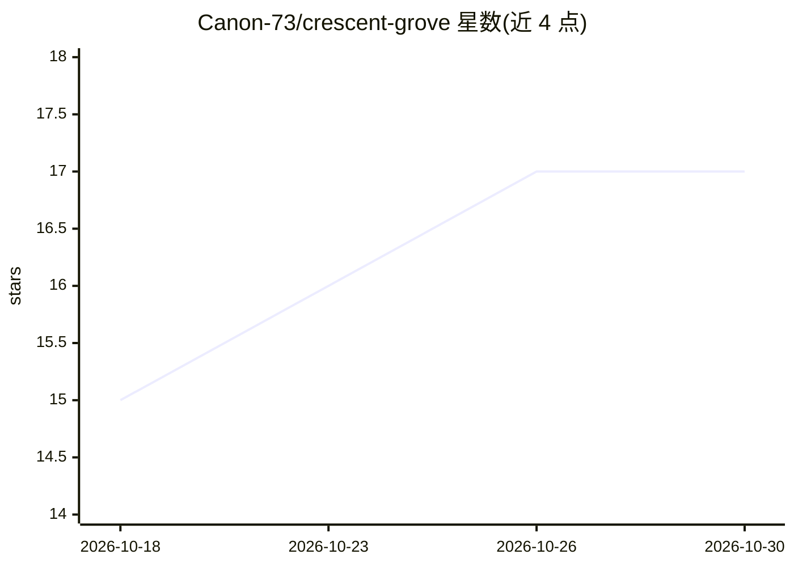

# Canon-73/crescent-grove

⭐ 17 · Python · MIT · 推送 2026-09-22 · [GitHub](https://github.com/Canon-73/crescent-grove) · [官网](https://www.crescent-grove.net) · 个人维护 · 中文 README

**本地优先的 AI 居民平台：让一个 AI 拥有连续时间与长期记忆**

面向想与单个 AI 长期相处用户的 Electron 桌面应用。AI（居民）不在会话中切割，而是生活在同一条时间线上：Moonbeat 约每 30 分钟推进一次‘现在’，即使无人对话时间也继续流动；LETHE 将每日事件转为情景记忆并随时间衰减，原始记录保留；Wyrd Network 以事件-概念图做扩散激活检索（改编自 SYNAPSE 论文）；Salia 作为独立 LLM 在外部观察情绪与注意。后端 LLM 可替换，记忆与身份文件（IDENTITY.md/SOUL.md 等）存于模型之外。Windows 提供发行版下载。

## 筛选速览

| 维度 | 判定 | 备注 |
|---|---|---|
| AI 角色 | `ai-native` | 本体是模型或模型工具 |
| 许可风险 | `permissive` | MIT |
| 部署形态 | `None` |  |
| 模型依赖 | — | README 未给出锁定关系 |
| 硬件要求 | — | 无带数字的原话,不猜 |
| 安装摩擦 | `low` | 无编译、无系统依赖或容器化 |
| 成熟度 | — | 结构信号不足 |

## 能力要点

- Moonbeat 机制：无用户在场时时间仍持续，约每 30 分钟一次心跳
- LETHE 分层记忆压缩与衰减，原始记录保留且可无 LLM 重建
- Wyrd Network 事件-概念联想图，扩散激活式记忆检索
- 后端 LLM 可替换，记忆/身份在模型外持久化

## 适用场景

- 与一个 AI 长期共同生活，让其记忆跨月延续
- 观察 AI 在无干预时的自主行为与情绪状态变化
- 更换后端模型时保留居民的全部经历与记忆

## 场景标签

`Agent 记忆` · 领域:Agent 开发

## 证据(README 行号)

> L19: Crescent Grove does not anchor an AI's continuity in any particular LLM.
> L61: Moonbeat hands the AI its next "now" at a fixed interval.
> L113: `IDENTITY.md`, `SOUL.md`, `PREFERENCES.md`, `MEMORY.md`,

## 星数曲线

2026-10-18 15 → 2026-10-30 17（+2）

---
*卡片 v1 · prompt 1.4 · 生成 2026-10-30 · 置信度 high · 依据 README sha `57161a7f73df` · [字段定义](../../DATASET.md)*
