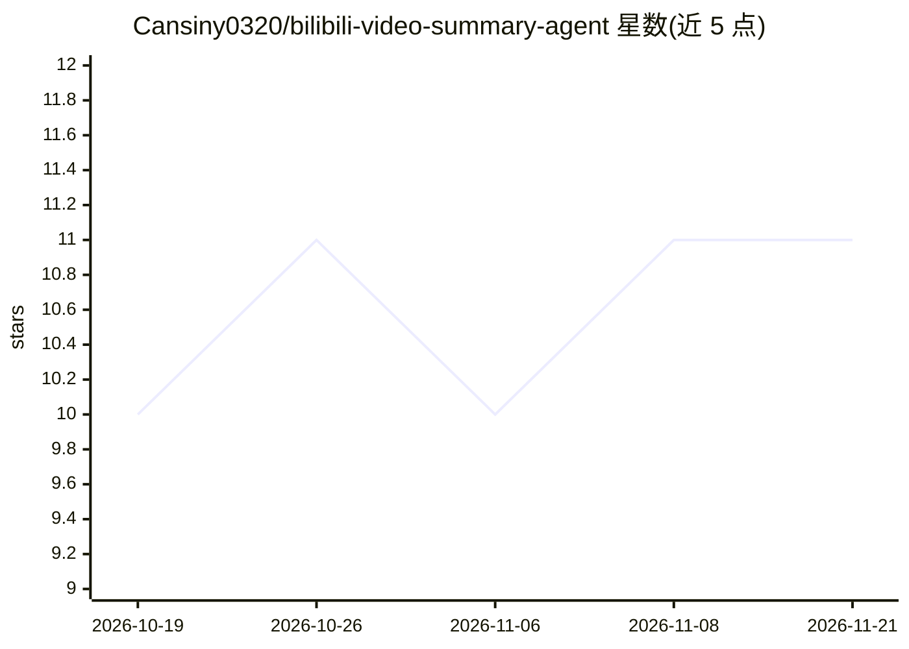

# Cansiny0320/bilibili-video-summary-agent

⭐ 11 · TypeScript · MIT · 推送 2026-10-24 · [GitHub](https://github.com/Cansiny0320/bilibili-video-summary-agent) · [官网](https://www.npmjs.com/package/bili-summary) · 个人维护 · 中文 README

**给 B 站用户的视频 AI 总结 CLI：字幕/转录生成带时间戳摘要**

命令行工具：输入 B 站视频 BV 号或链接，自动获取字幕（优先 AI 生成中文），无字幕时可调用转录模型处理音频（需本机 ffmpeg），用 LLM 生成含时间戳的摘要与关键要点。支持分 P 视频、自定义模型与 Base URL、结果保存到文件，并可在提供 B 站 Cookie 后自动发布总结到评论区。npm 全局安装，参数可全部经命令行传入或用 .env 作默认值，字幕获取含 WBI 校验逻辑。

## 筛选速览

| 维度 | 判定 | 备注 |
|---|---|---|
| AI 角色 | `ai-native` | 本体是模型或模型工具 |
| 许可风险 | `permissive` | MIT |
| 部署形态 | `library` | 以包/库形式分发 |
| 模型依赖 | — | README 未给出锁定关系 |
| 硬件要求 | — | 无带数字的原话,不猜 |
| 安装摩擦 | `medium` | 含编译或系统依赖之一 |
| 成熟度 | — | 结构信号不足 |

## 能力要点

- 输入 BV 号/URL 自动获取字幕并生成带时间戳的摘要与要点
- 无字幕时支持音频转录，可切换转录模型或火山语音识别
- 可选自动将总结发布到评论区（需 SESSDATA/bili_jct）
- 模型与 Base URL 可配置，兼容 OpenAI API 格式服务

## 适用场景

- 快速获取 B 站长视频的摘要和时间戳要点
- 自动为视频生成评论区总结
- 批量处理无字幕视频时启用音频转录

## 场景标签

`语音识别` · 领域:感知与多模态

## 证据(README 行号)

> L5: 一个命令行工具（CLI）：输入 B 站视频 BV 号或链接，自动获取字幕（或按需转录音频），用 LLM 生成「摘要 + 关键要点（带时间戳）」；可选自动发到评论区。
> L10: - 自动获取中文字幕（优先 AI 生成中文）
> L11: - 无字幕时可选音频转录（需要 ffmpeg）

## 星数曲线

2026-10-19 10 → 2026-11-21 11（+1）

---
*卡片 v1 · prompt 1.4 · 生成 2026-11-19 · 置信度 high · 依据 README sha `0797bc6dd8bb` · [字段定义](../../DATASET.md)*
