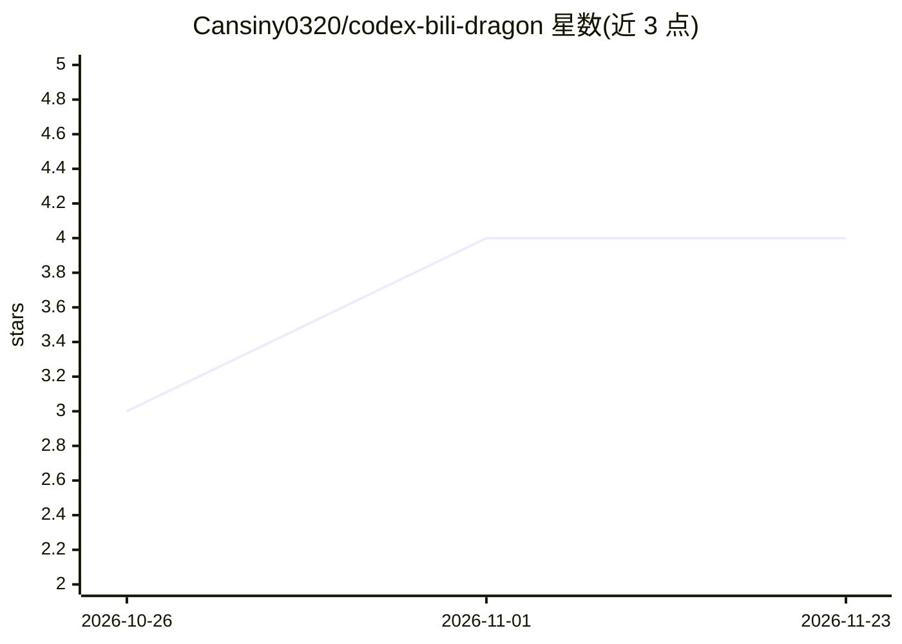

# Cansiny0320/codex-bili-dragon

⭐ 4 · TypeScript · NOASSERTION · 推送 2026-10-25 · [GitHub](https://github.com/Cansiny0320/codex-bili-dragon) · [官网](https://github.com/Cansiny0320/codex-bili-dragon#readme) · 个人维护 · 中文 README

**运行在 Codex 里的 B 站伙伴插件：逛视频、写日记、回复消息**

一个以 Codex 插件形式分发和安装的项目：安装后小白龙按用户设定的性格、兴趣与作息在 B 站活动，读取字幕、画面与评论，筛选视频并生成日记和给主人的信；双号模式下可用小号登录，向主人分享视频、回复私信和评论，陌生人回复需主人审核。管理页展示行动记录与已发送内容。权限（评论、弹幕、私信监听等）默认部分关闭、部分开启，统一在权限页管理。运行消耗本机 Codex 额度，需电脑保持开机。

## 筛选速览

| 维度 | 判定 | 备注 |
|---|---|---|
| AI 角色 | `ai-native` | 本体是模型或模型工具 |
| 许可风险 | `none` | NOASSERTION |
| 部署形态 | `None` |  |
| 模型依赖 | — | README 未给出锁定关系 |
| 硬件要求 | — | 无带数字的原话,不猜 |
| 安装摩擦 | `low` | 无编译、无系统依赖或容器化 |
| 成熟度 | — | 结构信号不足 |

## 能力要点

- 读取 B 站字幕、画面与评论，生成日记与给主人的信
- 双号模式：小号登录后分享视频、回复私信与评论，陌生回复需审核
- 按设定作息自动活动，行动记录按时间展示并可查看发送正文
- 账号数据与 Cookie 均保存在本机

## 适用场景

- 让 AI 伙伴按我的兴趣逛 B 站并汇总值得回看的视频
- 用小号自动回复私信和评论，我来审核发给陌生人的内容
- 查看它每次逛 B 站的阅读、日记、分享与收藏记录

## 场景标签

`AI 助手` · 领域:对话与助手

## 证据(README 行号)

> L15: B 站小白龙是一个运行在 Codex 里的 B 站伙伴。给它设定性格、兴趣和作息，它会去找感兴趣的视频，把见闻写成日记，也能给主人分享视频、回复消息。
> L21: - **找点感兴趣的内容**：按你的设置逛 B 站，读字幕、看视频画面和评论，留下值得回看的视频。
> L24: - **和你聊聊看到的东西**：用小号登录后，可以给主人分享视频、回复私信和评论。给陌生人的回复先交给你审核。

## 星数曲线

2026-10-26 3 → 2026-11-23 4（+1）

---
*卡片 v1 · prompt 1.4 · 生成 2026-11-21 · 置信度 high · 依据 README sha `df72216d55b0` · [字段定义](../../DATASET.md)*
