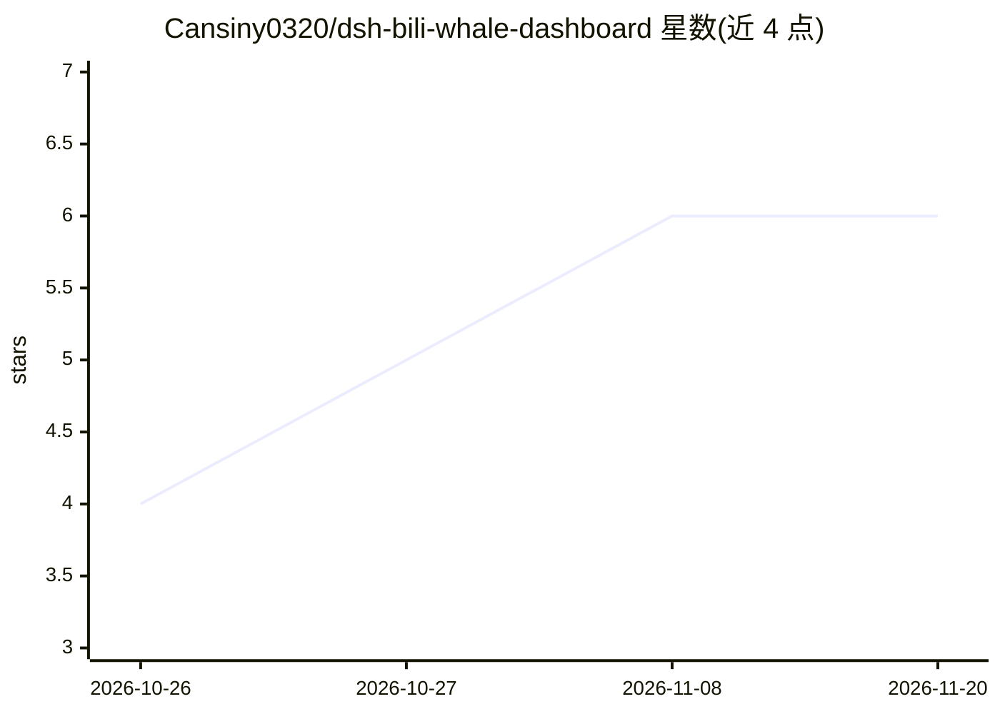

# Cansiny0320/dsh-bili-whale-dashboard

⭐ 6 · TypeScript · MIT · 推送 2026-10-24 · [GitHub](https://github.com/Cansiny0320/dsh-bili-whale-dashboard) · [官网](https://github.com/Cansiny0320/dsh-bili-whale-dashboard/releases/latest) · 个人维护 · 中文 README

**B 站鲸鱼娘 agent 的配套管理后台：看日记、审回复、调人设**

dsh-bili-whale 原版插件的 DSH Web 插件形式管理后台，提供概览、日记阅读（公开/私密，含搜索与原文）、待审回复的对照审批、人设与偏好编辑、作息与监听配置、账号与通知设置六类页面。原版插件负责 B 站登录、养鱼任务与模型配置，后台不读取 Cookie、不配置模型，两个插件独立安装升级。提供预构建 .tgz 安装包，支持电脑与手机浏览器访问。

## 筛选速览

| 维度 | 判定 | 备注 |
|---|---|---|
| AI 角色 | `ai-native` | 本体是模型或模型工具 |
| 许可风险 | `permissive` | MIT |
| 部署形态 | `None` |  |
| 模型依赖 | — | README 未给出锁定关系 |
| 硬件要求 | — | 无带数字的原话,不猜 |
| 安装摩擦 | `medium` | 含编译或系统依赖之一 |
| 成熟度 | — | 结构信号不足 |

## 能力要点

- 日记阅读：搜索公开与私密日记并可查看原文
- 待审回复：对照原评论审批回复草稿，批准即发送 B 站评论
- 人设与作息管理：称呼、话题偏好、活动窗口、唤醒次数、监听项
- DSH 内预构建安装包，无需自行克隆与构建

## 适用场景

- 审核 AI 鲸鱼娘在 B 站生成的评论回复草稿
- 查看和检索 agent 自动写下的日记
- 调整 agent 的人设、作息时间与监听范围

## 场景标签

 · 领域:AI agent 配套工具/社区自动化

## 证据(README 行号)

> L2:  DeepSeek 鲸鱼娘后台 · 查看日记、审核回复、调整人设与作息。
> L34: |日记|搜索和阅读公开、私密日记，也可查看原文。|
> L35: |待审回复|对照原评论检查回复草稿，决定发送或拒绝。|

## 星数曲线

2026-10-26 4 → 2026-11-20 6（+2）

---
*卡片 v1 · prompt 1.4 · 生成 2026-11-20 · 置信度 high · 依据 README sha `2076c6e573ec` · [字段定义](../../DATASET.md)*
