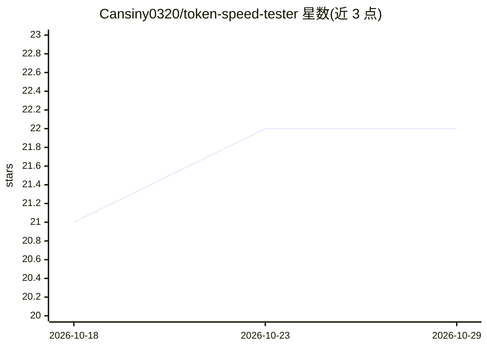

# Cansiny0320/token-speed-tester

⭐ 22 · TypeScript · MIT · 推送 2026-10-24 · [GitHub](https://github.com/Cansiny0320/token-speed-tester) · [官网](https://token-speed-studio.cansiny0320.chatgpt.site) · 个人维护 · 中文 README

**LLM/Codex 测速工具：测 TTFT、Token 吞吐与流式曲线**

包含 CLI（token-speed-tester）与桌面/网页工作台（Token Speed Studio）：测量 LLM 流式输出的 TTFT、平均/峰值吞吐与 TPS 曲线，支持三种接入（本机已登录 Codex 账号、OpenAI Chat Completions、Anthropic Messages）。可读取本机 Codex 历史会话与归档，按模型、推理强度、日期做统计分析并导出 JSON/CSV/HTML 报告，历史分析不调用模型。面向使用 Codex/ChatGPT 订阅或 API 的开发者；Codex 测试需先安装 Codex CLI 并登录，测试消耗账号额度。

## 筛选速览

| 维度 | 判定 | 备注 |
|---|---|---|
| AI 角色 | `ai-ecosystem` | LLM/agent 周边工具 |
| 许可风险 | `permissive` | MIT |
| 部署形态 | `library` | 以包/库形式分发 |
| 模型依赖 | locked-api |  |
| 硬件要求 | — | 无带数字的原话,不猜 |
| 安装摩擦 | `low` | 无编译、无系统依赖或容器化 |
| 成熟度 | — | 结构信号不足 |

## 能力要点

- 测量 TTFT、平均吞吐、峰值 TPS 与流式曲线，多轮统计
- 支持本机 Codex、OpenAI 兼容 API、Anthropic 兼容 API 三种接入
- Codex 历史会话本地分析（不调用模型），导出 JSON/CSV/HTML 报告
- CLI、网页与 macOS/Windows/Linux 桌面端三种形态

## 适用场景

- 比较不同模型或 API 端点的流式响应速度
- 分析本机 Codex 使用历史与用量统计
- 生成可存档的测速报告用于记录与对比

## 场景标签

`模型评测` · 领域:评测与运维

## 证据(README 行号)

> L19: - **测速指标**：TTFT、平均吞吐、单秒峰值、多轮统计；Studio 单独记录初始化耗时、输出和推理用量。
> L21: - **Codex 历史分析**：读取本机会话与归档，按日期、模型、推理强度和服务档位统计，查看轮次明细并导出 JSON / CSV；不调用模型。
> L152: |指标|说明|

## 星数曲线

2026-10-18 21 → 2026-10-29 22（+1）

---
*卡片 v1 · prompt 1.4 · 生成 2026-10-28 · 置信度 high · 依据 README sha `99500c2268d0` · [字段定义](../../DATASET.md)*
