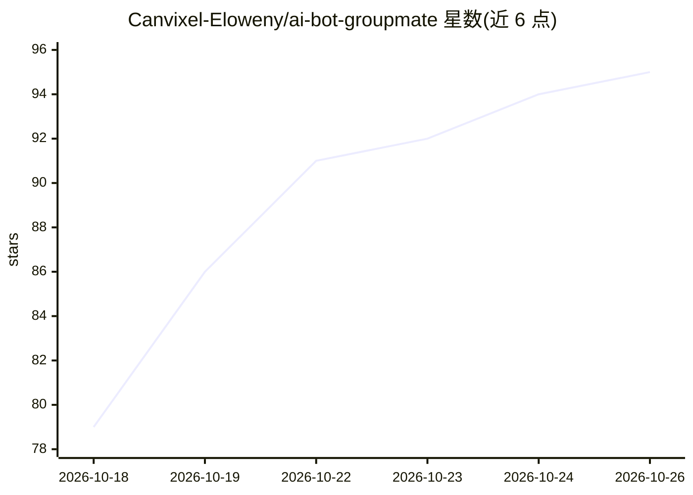

# Canvixel-Eloweny/ai-bot-groupmate

⭐ 95 · JavaScript · Apache-2.0 · 推送 2026-10-24 · [GitHub](https://github.com/Canvixel-Eloweny/ai-bot-groupmate) · [官网](https://github.com/Canvixel-Eloweny/ai-bot-groupmate) · 个人维护 · 中文 README

**把 QQ 小号接给大模型、让 AI 像群友一样聊天的机器人**

基于 Node.js 的 QQ 群 AI 群友机器人：通过 OneBot v11 协议（实际用 NapCatQQ）把一个备用 QQ 号接入任意 OpenAI 兼容模型，实现插话、接梗、按概率主动发言等群友行为。内置四套模型预设（本地 MLX/QwenChat、DeepSeek、智谱 GLM、通义千问），也可自定义任意 OpenAI 兼容端点。提供零构建网页控制台管理人格、技能、记忆与白名单。macOS/Linux 走 Docker 路线，Windows 提供打包版免 Docker；原生 macOS 路线当前受阻（QQ 版本白名单过期）。

## 筛选速览

| 维度 | 判定 | 备注 |
|---|---|---|
| AI 角色 | `ai-native` | 本体是模型或模型工具 |
| 许可风险 | `permissive` | Apache-2.0 |
| 部署形态 | `library` | 以包/库形式分发 |
| 模型依赖 | locked-api |  |
| 硬件要求 | — | 无带数字的原话,不猜 |
| 安装摩擦 | `low` | 无编译、无系统依赖或容器化 |
| 成熟度 | — | 结构信号不足 |

## 能力要点

- 四套模型预设 + 任意 OpenAI 兼容自定义端点
- 零构建网页控制台：切换模型、编辑人格、管理技能与记忆
- 触发/限流/CQ 注入防御/降级链等安全与稳定性机制
- 允许名单为空且未显式开启时拒绝启动（fail closed）

## 适用场景

- 让 AI 以群友身份在 QQ 群里插话、接梗、潜水
- 给备用 QQ 号配置自定义人格和人设扮演
- 用本地模型离线跑群聊机器人，数据不出本机

## 场景标签

`聊天机器人` · 领域:对话与助手

## 证据(README 行号)

> L5: **Turn a spare QQ account into an AI group member.**
> L53: An **OneBot v11 bridge** that plugs a spare QQ account into any OpenAI-compatible model, plus a

## 星数曲线

2026-10-18 79 → 2026-10-26 95（+16）

---
*卡片 v1 · prompt 1.4 · 生成 2026-10-23 · 置信度 high · 依据 README sha `50cf2776b5d4` · [字段定义](../../DATASET.md)*
