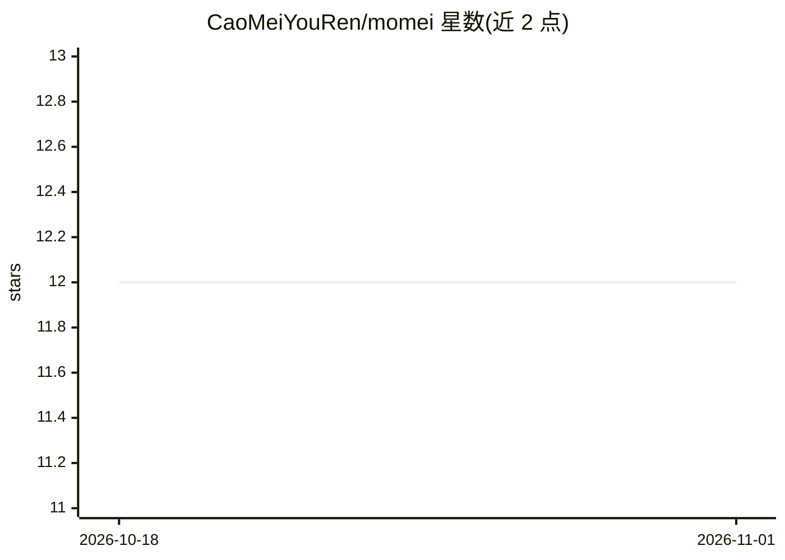

# CaoMeiYouRen/momei

⭐ 12 · TypeScript · MIT · 推送 2026-10-31 · [GitHub](https://github.com/CaoMeiYouRen/momei) · [官网](https://demo.momei.app/) · 个人维护 · 中文 README

**AI 驱动、原生国际化的开发者博客平台**

基于 Nuxt (Vue 3 + TypeScript) 构建的博客平台，面向技术开发者与跨境内容创作者。AI 能力包括全自动翻译、智能标题、摘要生成、AI 配图、ASR 语音输入与评论区只读翻译；同时提供多语言路由、SSG/SSR 混合渲染、多层级 RSS、S3/R2 直传与系统设置治理。数据库支持 SQLite/MySQL/PostgreSQL，附 Hexo 迁移 CLI。可用 Vercel/Docker/自托管 Node 部署，暂不支持完整部署到 Cloudflare Pages/Workers。

## 筛选速览

| 维度 | 判定 | 备注 |
|---|---|---|
| AI 角色 | `ai-enhanced` | 去掉 AI 部分产品仍成立 |
| 许可风险 | `permissive` | MIT |
| 部署形态 | `self-host` | docker 或自建部署 |
| 模型依赖 | — | README 未给出锁定关系 |
| 硬件要求 | — | 无带数字的原话,不猜 |
| 安装摩擦 | `low` | 无编译、无系统依赖或容器化 |
| 成熟度 | — | 结构信号不足 |

## 能力要点

- AI 全自动翻译、智能标题与摘要生成
- 多模态工作流：AI 配图、ASR、可复用语音输入与定时分发任务
- 原生 i18n：UI 与内容管理深度集成多语言支持
- S3/R2 直传授权与多层级 RSS 订阅

## 适用场景

- 搭建多语言个人博客并触达全球读者
- 用 AI 自动完成文章翻译、标题与摘要生成
- 从 Hexo 博客批量迁移文章与元数据

## 场景标签

`AI 写作` · 领域:内容生成

## 证据(README 行号)

> L38: > **墨梅博客 - AI 驱动、原生国际化的开发者博客平台。**
> L48: - **AI 驱动**: 深度集成 AI 助手，支持全自动翻译、智能标题、摘要生成等功能，大幅提升创作效率。
> L49: - **多模态内容工作流**: 已支持 AI 配图、ASR、可复用语音输入、Memos / WechatSync 手动分发与定时任务自动化，覆盖从灵感采集到发布的完整链路。

## 星数曲线

2026-10-18 12 → 2026-11-01 12（+0）

---
*卡片 v1 · prompt 1.4 · 生成 2026-11-01 · 置信度 mid · 依据 README sha `fe600f412b75` · [字段定义](../../DATASET.md)*
