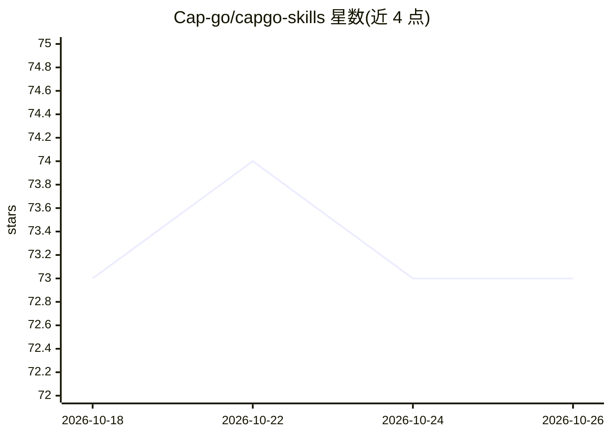

# Cap-go/capgo-skills

⭐ 73 · JavaScript · MIT · 推送 2026-10-17 · [GitHub](https://github.com/Cap-go/capgo-skills) · [官网](https://capgo.app) · 组织维护

**面向 AI 编码代理的 Capacitor 移动开发技能库**

Capgo 维护的 agent 技能合集：以打包指令形式扩展 Claude Code、Codex、Cursor、Copilot、Gemini CLI 等 AI 编码代理在 Capacitor 移动开发中的能力，覆盖构建、插件、迁移（Cordova/Appflow/Capawesome 等）、版本升级（至 Capacitor 9）、调试、测试、安全扫描（Capsec 63+ 规则）、上架发布与 OTA 热更新等生命周期环节。可通过 npx skills add、Claude Code 插件市场、Gemini CLI extensions 或 Cursor/Codex 插件市场安装，并可配合 Capgo 托管或本地 MCP server 管理应用与构建。

## 筛选速览

| 维度 | 判定 | 备注 |
|---|---|---|
| AI 角色 | `ai-knowledge` | 知识聚合/清单类 |
| 许可风险 | `permissive` | MIT |
| 部署形态 | `library` | 以包/库形式分发 |
| 模型依赖 | — | README 未给出锁定关系 |
| 硬件要求 | — | 无带数字的原话,不猜 |
| 安装摩擦 | `low` | 无编译、无系统依赖或容器化 |
| 成熟度 | — | 结构信号不足 |

## 能力要点

- 覆盖构建/迁移/升级/调试/安全/发布/热更新全生命周期的技能集
- 支持 skills.sh、Claude Code 插件市场、Gemini CLI、Cursor、Codex 多渠道安装
- 11 个插件分组（云工作流、UI、质量、部署等）按需安装
- 可连接 Capgo 托管或本地 MCP server 管理 app、渠道、bundle 与构建

## 适用场景

- 让 Claude Code/Cursor 等 AI 编码代理按最佳实践开发 Capacitor 应用
- 把 Cordova/Appflow/Capawesome 项目迁移到 Capacitor 或 Capgo
- 通过 agent 完成 Capacitor 跨大版本升级（最高到 v9）
- 用 agent 执行安全扫描、测试、上架与 OTA 热更新流程

## 场景标签

`提示工程` · 领域:Agent 开发

## 证据(README 行号)

> L9: Agent skills for building, shipping, and maintaining Capacitor apps with AI coding agents (Claude Code, Codex, Curso
> L11: These skills are maintained by Capgo, the AI-ready platform to build, ship, and maintain Capacitor apps: Capacitor 

## 星数曲线

2026-10-18 73 → 2026-10-26 73（+0）

---
*卡片 v1 · prompt 1.4 · 生成 2026-10-24 · 置信度 high · 依据 README sha `1a512e5520f1` · [字段定义](../../DATASET.md)*
