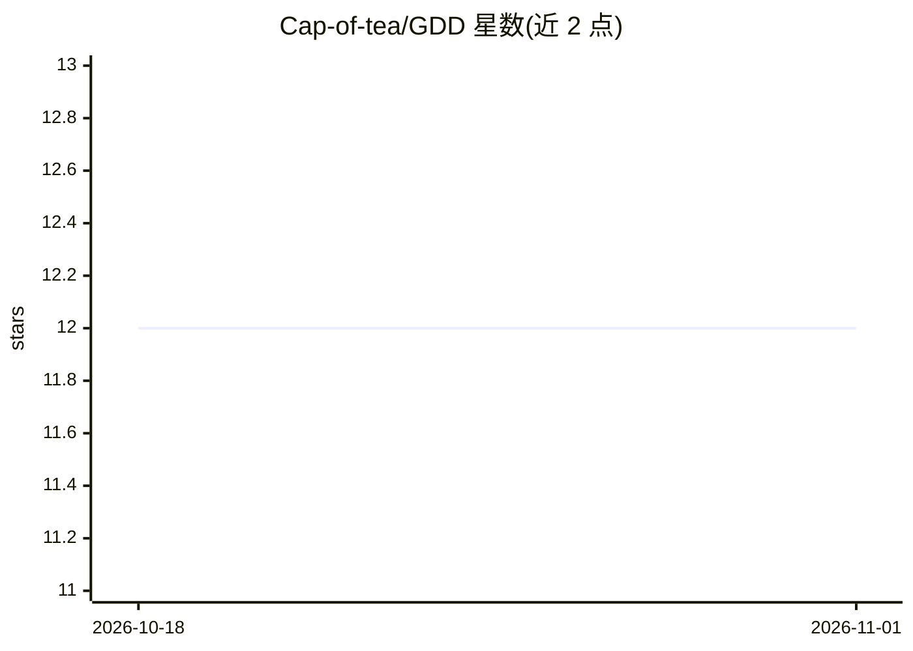

# Cap-of-tea/GDD

⭐ 12 · C# · NOASSERTION · 推送 2026-10-14 · [GitHub](https://github.com/Cap-of-tea/GDD) · 个人维护

**给开发者的 AI 浏览器农场：39 个 MCP 工具驱动多 Chromium 实例**

本机运行的多浏览器自动化服务：启动 N 个隔离 Chromium 实例，每个拥有独立 profile、cookies、设备模拟、地理位置与网络条件，通过 HTTP 在 localhost:9700 暴露 39 个 MCP 工具，供 Claude Code、Cursor 等 MCP 客户端以自然语言驱动并发测试。提供无头 Server 版（支持 Docker、CI/CD）与带视频墙 GUI 的 Desktop 版（Windows/Linux/macOS）。输入走真实键盘事件链并支持多语言物理键位（US/RU/DE/FR），含 humanize 拟人光标与 anti-bot 隐匿选项。Chromium 首次启动时自动下载。

## 筛选速览

| 维度 | 判定 | 备注 |
|---|---|---|
| AI 角色 | `ai-ecosystem` | LLM/agent 周边工具 |
| 许可风险 | `none` | NOASSERTION |
| 部署形态 | `desktop` | 安装包/桌面程序 |
| 模型依赖 | locked-api |  |
| 硬件要求 | — | 无带数字的原话,不猜 |
| 安装摩擦 | `low` | 无编译、无系统依赖或容器化 |
| 成熟度 | — | 结构信号不足 |

## 能力要点

- 39 个 MCP 工具覆盖导航、交互、截图、模拟与诊断
- N 个隔离 Chromium 实例，22 种设备预设
- 真实键盘事件链与多语言物理键位布局
- Docker 镜像与无头模式支持 CI/CD

## 适用场景

- 让 Claude Code 或 Cursor 并发在多设备上测试站点
- 在 CI/CD 中无头运行多浏览器自动化
- 模拟不同网络、地理位置与设备环境做兼容性检查

## 场景标签

`浏览器自动化` · 领域:效率与自动化

## 证据(README 行号)

> L32: GDD runs N isolated Chromium instances, each with its own profile, cookies, device emulation, geolocation, and netw
> L212: - **AI-native** — 39 MCP tools for Claude Code, Cursor, or any MCP-compatible client

## 星数曲线

2026-10-18 12 → 2026-11-01 12（+0）

---
*卡片 v1 · prompt 1.4 · 生成 2026-11-01 · 置信度 high · 依据 README sha `4e3fc0292e51` · [字段定义](../../DATASET.md)*
