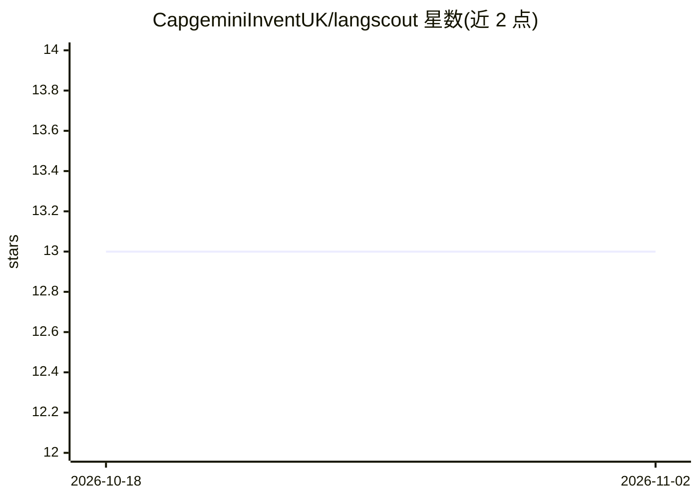

# CapgeminiInventUK/langscout

⭐ 13 · TypeScript · GPL-3.0 · 推送 2026-11-01 · [GitHub](https://github.com/CapgeminiInventUK/langscout) · 组织维护

**Langchain 应用 LLM 追踪工具：存入 MongoDB 并可视化**

由 Capgemini Invent UK 维护的 LLM 追踪工具：消费 Langchain/Langsmith 的追踪数据并存入 MongoDB，通过自带 UI 或 MongoDB Atlas Charts 查询与可视化。功能含反馈创建与更新、UI 认证（GitHub、Microsoft AD）、通过 MongoDB Trigger 自动附加 token 用量与延迟数据。以 Full Mode（UI+API+Ingest）或 Headless Mode（仅 Ingest）两种模式经 Docker Compose 运行；token 用量等部分功能依赖 MongoDB Atlas。基于 Next.js、Node.js 20、TypeScript 构建，接入无需 API key。

## 筛选速览

| 维度 | 判定 | 备注 |
|---|---|---|
| AI 角色 | `ai-ecosystem` | LLM/agent 周边工具 |
| 许可风险 | `viral` | GPL-3.0 |
| 部署形态 | `self-host` | docker 或自建部署 |
| 模型依赖 | — | README 未给出锁定关系 |
| 硬件要求 | — | 无带数字的原话,不猜 |
| 安装摩擦 | `low` | 无编译、无系统依赖或容器化 |
| 成熟度 | — | 结构信号不足 |

## 能力要点

- 摄取 Langchain/Langsmith 追踪数据并存入 MongoDB
- UI 查看追踪数据与反馈管理（GitHub/Microsoft AD 认证）
- MongoDB Trigger 自动附加 token 用量与延迟数据
- Full/Headless 两种运行模式，Docker Compose 部署

## 适用场景

- Langchain 应用团队查看与检索 LLM 调用追踪
- 通过 UI 或 Atlas Charts 分析 token 用量与延迟
- 对追踪数据记录反馈用于迭代评估

## 场景标签

`LLM 可观测性` · 领域:评测与运维

## 证据(README 行号)

> L19: Langscout is an LLM tracing tool that consumes the data from Langchain and saves the data to
> L27: - Ingests trace data from Langchain/Langsmith

## 星数曲线

2026-10-18 13 → 2026-11-02 13（+0）

---
*卡片 v1 · prompt 1.4 · 生成 2026-10-31 · 置信度 mid · 依据 README sha `368cf6b6e862` · [字段定义](../../DATASET.md)*
