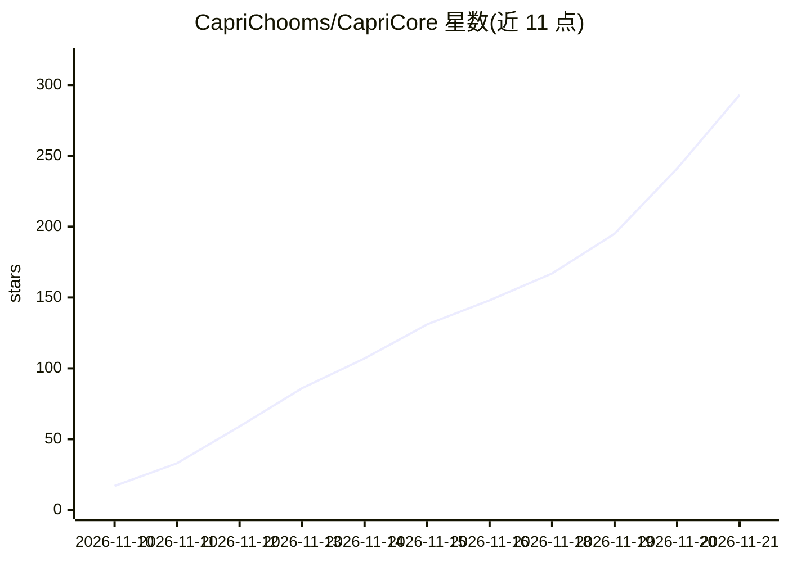

# CapriChooms/CapriCore

⭐ 293 · JavaScript · GPL-3.0 · 推送 2026-11-15 · [GitHub](https://github.com/CapriChooms/CapriCore) · [官网](https://capri-core.com/) · 组织维护

**Windows 桌面 AI 伴侣：本地/API 模型对话、语音与桌面工具**

面向 Windows 10/11 x64 用户的桌面 AI 伴侣应用：支持捆绑 Qwen3.5 本地模型、Hugging Face GGUF 导入（托管于 llama.cpp 运行时）或 OpenAI 兼容 API（OpenRouter/DeepSeek/Gemini 等预设），提供共享对话与记忆、可搜索记忆事实、本地文档知识库、可选本地语音识别与 TTS、51 种界面语言，以及经权限授权的桌面工具（应用/文件操作、Spotify/Discord 控制、网页搜索，计算机控制为 BETA）。含动画桌宠形象、BPM 音乐反应等桌面伴侣功能。提供安装程序与源码运行两种途径。

## 筛选速览

| 维度 | 判定 | 备注 |
|---|---|---|
| AI 角色 | `ai-native` | 本体是模型或模型工具 |
| 许可风险 | `viral` | GPL-3.0 |
| 部署形态 | `desktop` | 安装包/桌面程序 |
| 模型依赖 | local-ok | 支持本地模型 |
| 硬件要求 | — | 无带数字的原话,不猜 |
| 安装摩擦 | `medium` | 含编译或系统依赖之一 |
| 成熟度 | `idea` | |

## 能力要点

- 本地 GGUF（llama.cpp 运行时）/ 捆绑模型 / OpenAI 兼容 API 三种推理模式
- 本地语音识别与 TTS（Chatterbox、Qwen3-TTS CPU BETA），默认启动不加载
- 权限制的桌面工具与可见指示的 BETA 计算机控制
- 可搜索记忆事实与本地文档知识库

## 适用场景

- 在桌面上与本地或 API 大模型持续对话并保留记忆
- 让 AI 在授权范围内执行应用/文件与网页搜索等桌面操作
- 以桌宠形式获得带语音与动画反应的陪伴体验

## 场景标签

`AI 助手` `GUI 自动化` `文档问答` · 领域:效率与自动化

## 证据(README 行号)

> L5: A Windows AI desktop companion powered by OpenClaw: bundled local LLMs, Hugging Face GGUF models or OpenAI-compatibl
> L17: - **Talk and remember.** Text chat, optional local speech recognition and voice, independent language settings, com
> L20: - **Use tools with permission.** Scoped app/file actions, Spotify, Discord desktop control, web search, deep-thinki

## 星数曲线

2026-11-10 17 → 2026-11-21 293（+276）

---
*卡片 v1 · prompt 1.4 · 生成 2026-11-17 · 置信度 high · 依据 README sha `2792ab0c4e71` · [字段定义](../../DATASET.md)*
