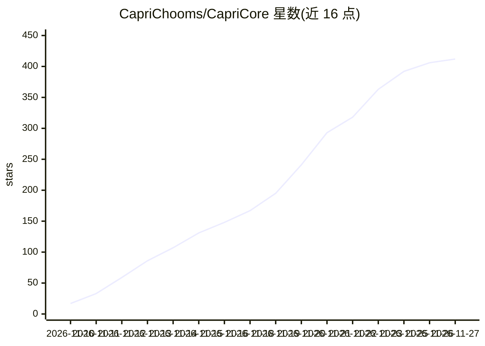

# CapriChooms/CapriCore

⭐ 412 · JavaScript · GPL-3.0 · 推送 2026-11-26 · [GitHub](https://github.com/CapriChooms/CapriCore) · [官网](https://capri-core.com/) · 组织维护

**Windows 桌面 AI 伴侣应用：文本/语音对话、记忆与桌面工具**

基于 OpenClaw 的 Windows AI 桌面伴侣，提供文本与语音聊天、持久记忆、动画桌面头像以及基于权限的应用/文件工具。推理可选三种方式：内置 Qwen3.5 本地模型、导入 Hugging Face GGUF 权重（经 llama.cpp Vulkan 运行时），或连接 OpenAI 兼容 API（OpenRouter/DeepSeek/Gemini 等预设）。带 CPU/GPU 负载控制、本地语音识别与 TTS、本地文档知识库。提供 Windows 安装向导；源码方式需 Node.js 24.x 与 llama.cpp 运行时。语音与计算机控制在部分配置下标注 BETA，安装包未签名。

## 筛选速览

| 维度 | 判定 | 备注 |
|---|---|---|
| AI 角色 | `ai-native` | 本体是模型或模型工具 |
| 许可风险 | `viral` | GPL-3.0 |
| 部署形态 | `desktop` | 安装包/桌面程序 |
| 模型依赖 | local-ok | 支持本地模型 |
| 硬件要求 | `gpu-8g` | |
| 安装摩擦 | `medium` | 含编译或系统依赖之一 |
| 成熟度 | — | 结构信号不足 |

## 能力要点

- 三种推理来源：内置 Qwen3.5、GGUF 导入、OpenAI 兼容 API，可切换不丢对话
- 本地语音识别与 TTS（Chatterbox/Qwen3-TTS），语音与麦克风默认关闭
- 权限范围化的应用/文件/Spotify/Discord 桌面工具与录制工作流
- 32K 上下文硬件档位表与 CPU/GPU 负载控制

## 适用场景

- 在 Windows 桌面上运行一个带动画形象和持久记忆的本地 AI 伴侣
- 用语音与本地模型对话，避免云端数据上传
- 通过权限审批让 AI 执行应用、文件与 Discord/Spotify 操作
- 导入自己挑选的 Hugging Face GGUF 模型作为对话模型

## 场景标签

`AI 助手` `语音 Agent` `GUI 自动化` · 领域:效率与自动化

## 证据(README 行号)

> L5: Capri is a Windows AI desktop companion powered by OpenClaw. Run a bundled local model, import a compatible Hugging 
> L22: - **Choose your inference.** Use bundled Qwen3.5 models, BETA Gemma/Ministral alternatives, compatible Hugging Face
> L75: **Windows 10 22H2 or Windows 11, x64.** The smallest supported configuration has

## 星数曲线

2026-11-10 17 → 2026-11-27 412（+395）

---
*卡片 v1 · prompt 1.4 · 生成 2026-11-25 · 置信度 high · 依据 README sha `94cba91d80c5` · [字段定义](../../DATASET.md)*
