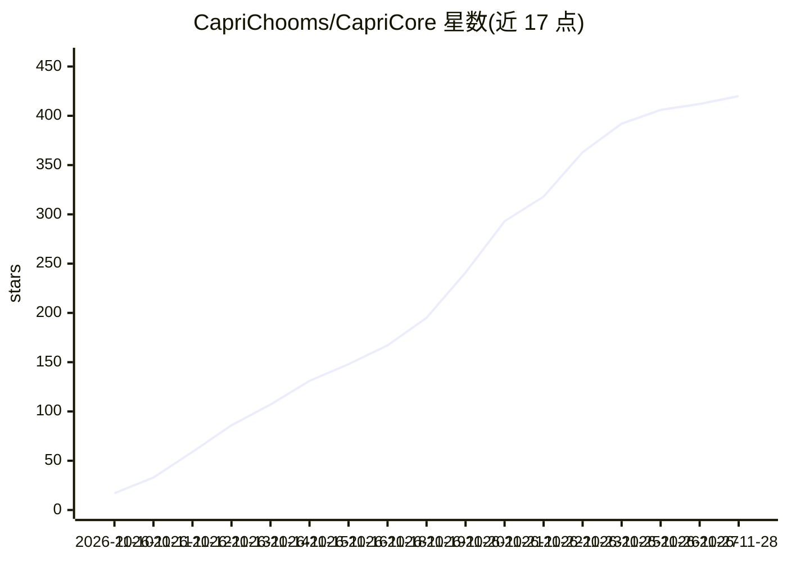

# CapriChooms/CapriCore

⭐ 420 · JavaScript · GPL-3.0 · 推送 2026-11-27 · [GitHub](https://github.com/CapriChooms/CapriCore) · [官网](https://capri-core.com/) · 组织维护

**Windows 桌面 AI 伴侣：本地/API 模型、语音、记忆与桌面工具**

基于 OpenClaw 的 AI 桌面伴侣应用，支持捆绑 Qwen3.5 本地模型、导入 Hugging Face GGUF 模型或连接 OpenAI 兼容 API，提供文本与语音对话、可搜索记忆、本地文档知识库、动画桌面形象，以及基于权限的桌面工具（应用/文件操作、Spotify/Discord 控制、网页搜索）。Windows 提供安装向导，Linux/macOS 另有安装指南；源码方式需 Node.js 24.x 与 llama.cpp Vulkan 运行时。语音回复默认关闭，部分功能标注 BETA。

## 筛选速览

| 维度 | 判定 | 备注 |
|---|---|---|
| AI 角色 | `ai-native` | 本体是模型或模型工具 |
| 许可风险 | `viral` | GPL-3.0 |
| 部署形态 | `desktop` | 安装包/桌面程序 |
| 模型依赖 | local-ok | 支持本地模型 |
| 硬件要求 | `gpu-8g` | |
| 安装摩擦 | `medium` | 含编译或系统依赖之一 |
| 成熟度 | — | 结构信号不足 |

## 能力要点

- 支持捆绑本地模型、GGUF 导入与 OpenAI 兼容 API 三种推理方式，可切换不清空对话
- CPU/GPU 负载控制（默认 85% 上限）、模型按需加载与空闲卸载
- 本地语音识别与 TTS（Chatterbox/Qwen3-TTS 适配器）
- 基于权限的桌面工具：作用域化应用/文件操作、录制的自动化流程、BETA 计算机控制带可视指示与 Escape 取消

## 适用场景

- 在桌面养一个可对话、有记忆、有动画形象的 AI 伴侣
- 本地运行 GGUF 模型或接入自有 API 做日常问答
- 让 AI 在授权范围内代为操作应用、文件与 Spotify/Discord

## 场景标签

`AI 助手` `GUI 自动化` · 领域:效率与自动化

## 证据(README 行号)

> L5: Capri is an AI desktop companion powered by OpenClaw. Run a bundled local model, import a compatible Hugging Face GG
> L23: - **Choose your inference.** Use bundled Qwen3.5 models, BETA Gemma/Ministral alternatives, compatible Hugging Face
> L28: - **Use tools with permission.** Scoped app/file actions, Spotify, Discord desktop control, web search, deep-thinki

## 星数曲线

2026-11-10 17 → 2026-11-28 420（+403）

---
*卡片 v1 · prompt 1.4 · 生成 2026-11-28 · 置信度 high · 依据 README sha `07061e52bfc3` · [字段定义](../../DATASET.md)*
