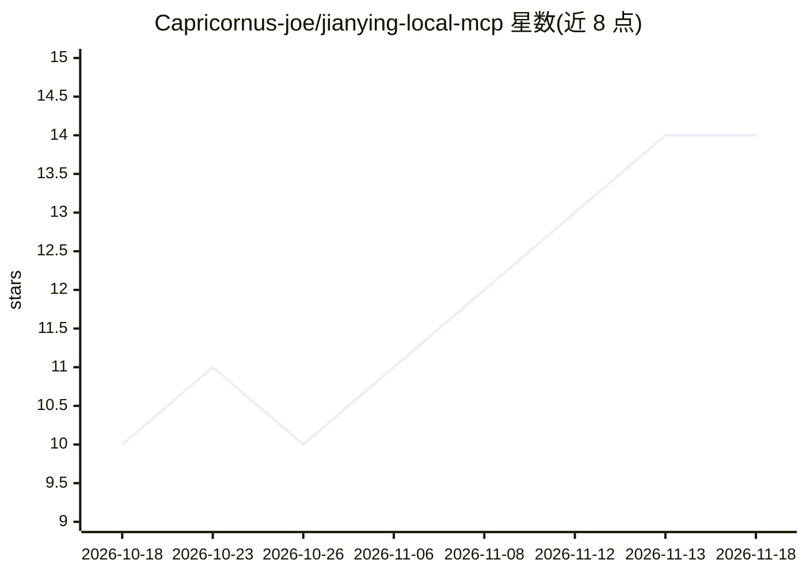

# Capricornus-joe/jianying-local-mcp

⭐ 14 · Python · MIT · 推送 2026-09-18 · [GitHub](https://github.com/Capricornus-joe/jianying-local-mcp) · 个人维护 · 中文 README

**让 AI 通过 MCP 驱动 Mac 剪映自动生成草稿的工具**

面向 Mac 剪映的本地 MCP 服务，提供 22 个工具，通过本地 stdio 运行。在支持 MCP 的 AI 客户端中提供素材与剪辑要求后，AI 调用工具生成剪映草稿，再由用户在剪映中打开、预览和导出。功能覆盖镜头编排、关键帧动画（9 种线性运动预设）、SRT 字幕导入导出与批量样式修改、多轨剪辑和 batch_edit 一次性批量编辑。要求 macOS、Python 3.11+ 与本机已安装剪映；仅修改本工具管理的计划，手动修改不回同步。

## 筛选速览

| 维度 | 判定 | 备注 |
|---|---|---|
| AI 角色 | `ai-ecosystem` | LLM/agent 周边工具 |
| 许可风险 | `permissive` | MIT |
| 部署形态 | `None` |  |
| 模型依赖 | — | README 未给出锁定关系 |
| 硬件要求 | — | 无带数字的原话,不猜 |
| 安装摩擦 | `low` | 无编译、无系统依赖或容器化 |
| 成熟度 | — | 结构信号不足 |

## 能力要点

- 22 个 MCP 工具通过本地 stdio 运行
- 关键帧动画：位置/缩放/旋转/透明度，内置 9 种线性运动预设
- SRT 字幕导入导出与单条/整轨批量样式修改
- batch_edit 一次调用完成多项修改并保存为新版本

## 适用场景

- 在 MCP 客户端里用自然语言描述要求，让 AI 生成剪映草稿
- 批量修改字幕内容、样式并保留原项目版本
- 对照片素材制作推近、滑入、渐显等运镜动画

## 场景标签

`图像视频处理` · 领域:感知与多模态

## 证据(README 行号)

> L3: **Jianying Local MCP** 是一个用于 Mac 剪映的本地 MCP 工具，支持镜头编排、字幕、关键帧动画和多轨剪辑。
> L5: 在支持 MCP 的 AI 客户端中提供素材和剪辑要求，AI 调用工具生成剪映草稿，再用剪映打开、预览和导出。
> L74: 当前版本提供 22 个工具，通过本地 stdio 运行。Mac 草稿兼容性仍在测试中，生成后需要在剪映内检查和导出。

## 星数曲线

2026-10-18 10 → 2026-11-18 14（+4）

---
*卡片 v1 · prompt 1.4 · 生成 2026-11-18 · 置信度 high · 依据 README sha `70df4cfa01a4` · [字段定义](../../DATASET.md)*
