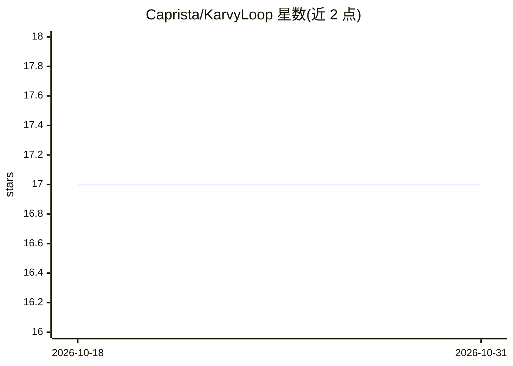

# Caprista/KarvyLoop

⭐ 17 · Python · MIT · 推送 2026-09-28 · [GitHub](https://github.com/Caprista/KarvyLoop) · 组织维护 · 中文 README

**本地优先的多 agent 循环运行时：AI 提案、用户决策、技能沉淀**

KarvyLoop 是在本机运行 AI agent 团队的运行时：用户以域（公司）、角色（agent）、原子（子 agent）组装团队，内置助手 Karvy 以自然语言编排，产出决策卡片，经用户确认（H2A 规则）后才执行。核心机制是循环沉淀：重复任务通过验证门后固化为可复用技能（SKILL.md），用户的接受/拒绝选择固化为决策偏好，知识以网格图形式存储并支持冲突消解。提供多 provider LLM 网关（Anthropic/OpenAI 兼容端点、MCP、可选 Ollama）、三平台沙箱（bubblewrap/Seatbelt/restricted-token）、token/成本上限刹车与多设备 mesh 同步。MIT 许可，本地优先（数据存于 ~/.karvyloop/，不上传）。

## 筛选速览

| 维度 | 判定 | 备注 |
|---|---|---|
| AI 角色 | `ai-ecosystem` | LLM/agent 周边工具 |
| 许可风险 | `permissive` | MIT |
| 部署形态 | `library` | 以包/库形式分发 |
| 模型依赖 | local-ok | 支持本地模型 |
| 硬件要求 | — | 无带数字的原话,不猜 |
| 安装摩擦 | `low` | 无编译、无系统依赖或容器化 |
| 成熟度 | — | 结构信号不足 |

## 能力要点

- H2A 决策卡片机制：AI 提案、用户确认，统计门槛（Wilson 95% 下界≥0.90）后才提议静默处理
- 循环固化：任务沉淀为 SKILL.md 技能（部分复用路径零 LLM 调用），选择沉淀为决策偏好
- 多 provider LLM 网关（Anthropic/OpenAI 兼容端点 + MCP + 可选本地 Ollama），缓存稳定前缀
- 三平台沙箱执行与能力令牌校验；跨设备 mesh 同步（无中心服务器）

## 适用场景

- 让本地 agent 团队跑周期性重复工作并在人工确认下执行
- 把重复任务固化为技能以降低后续运行的 LLM 调用成本
- 多台设备间同步 agent 技能与知识库

## 场景标签

`Agent 框架` `多智能体` `模型网关` · 领域:Agent 开发

## 证据(README 行号)

> L32: KarvyLoop is a runtime for **AI agents that run on your own machine**. You assemble a team: business *domains* (a "
> L64: - 🔌 **Multi-provider LLM gateway + MCP.** Any Anthropic- or OpenAI-compatible endpoint; one gateway choke-point met
> L40: Where most agent frameworks make a *single* LLM call more reliable, KarvyLoop is **loop-native**: the unit of desig

## 星数曲线

2026-10-18 17 → 2026-10-31 17（+0）

---
*卡片 v1 · prompt 1.4 · 生成 2026-10-30 · 置信度 mid · 依据 README sha `28da5e7dd1f5` · [字段定义](../../DATASET.md)*
