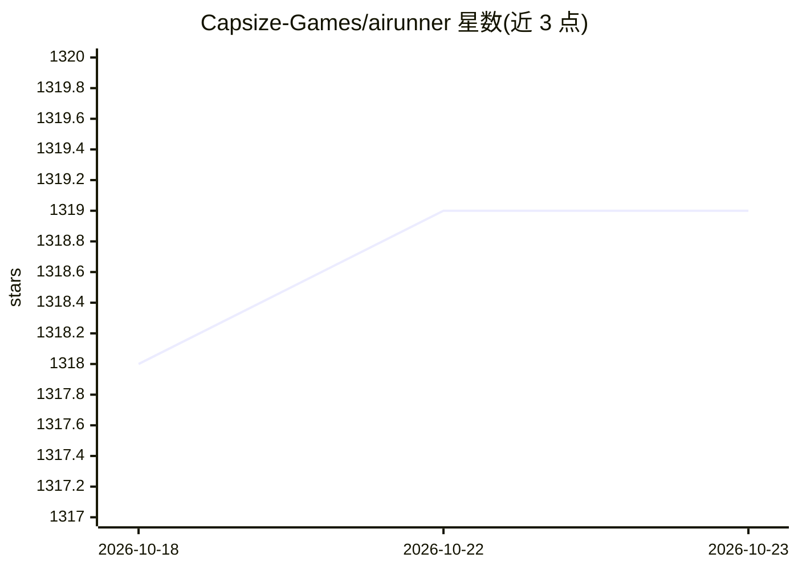

# Capsize-Games/airunner

⭐ 1,319 · Python · GPL-3.0 · 推送 2026-10-14 · [GitHub](https://github.com/Capsize-Games/airunner) · [官网](https://airunner.art) · 组织维护

**离线桌面 AI 伴侣与 AI 艺术生成应用（本地运行）**

GPL-3.0 桌面应用：可定制姓名、性格、语音与长期记忆的 AI 伴侣（含 TTS/STT 实时语音对话、RAG 记忆召回），叠加多层画布式 AI 图像生成（草图转图、图生图、修复、滤镜）。默认全部在本地硬件运行，无需 API key 或订阅；LLM 经 llama.cpp sidecar 运行 GGUF 模型，内置 HuggingFace 与 Civitai 模型下载器。提供桌面安装包、Docker、apt、PyPI 多种安装途径，最低要求 16GB 内存。

## 筛选速览

| 维度 | 判定 | 备注 |
|---|---|---|
| AI 角色 | `ai-native` | 本体是模型或模型工具 |
| 许可风险 | `viral` | GPL-3.0 |
| 部署形态 | `self-host` | docker 或自建部署 |
| 模型依赖 | local-ok | 支持本地模型 |
| 硬件要求 | `gpu-8g` | |
| 安装摩擦 | `low` | 无编译、无系统依赖或容器化 |
| 成熟度 | — | 结构信号不足 |

## 能力要点

- 可定制性格/语音/长期记忆的 AI 伴侣，支持实时语音对话
- 多层画布 AI 图像生成：草图转图、图生图、修复、背景移除
- 本地离线运行，llama.cpp sidecar 跑 GGUF LLM，whisper.cpp 做 STT
- 内置 HuggingFace 与 Civitai 模型下载器及 NSFW/违规内容过滤器

## 适用场景

- 在本地运行一个有记忆和语音的私人 AI 伴侣
- 在分层画布上绘制并生成、迭代 AI 图像
- 无网络、无 API key 环境下使用 LLM 对话与语音交互

## 场景标签

`聊天机器人` `语音 Agent` `Agent 记忆` `图像生成` · 领域:Agent 开发

## 证据(README 行号)

> L5: AI Runner is a private AI companion you shape — name, personality, voice, memory — and a layered canvas for AI art g
> L53: |**🤖 AI Companion**|Shape a named, voiced companion with persistent personality, shifting mood, and long-term memor
> L56: |**🗣️ Voice Conversation**|Full TTS and STT — speak to your companion and hear it respond in a voice you choose|

## 星数曲线

2026-10-18 1,318 → 2026-10-23 1,319（+1）

---
*卡片 v1 · prompt 1.4 · 生成 2026-10-21 · 置信度 high · 依据 README sha `c1193a906f88` · [字段定义](../../DATASET.md)*
