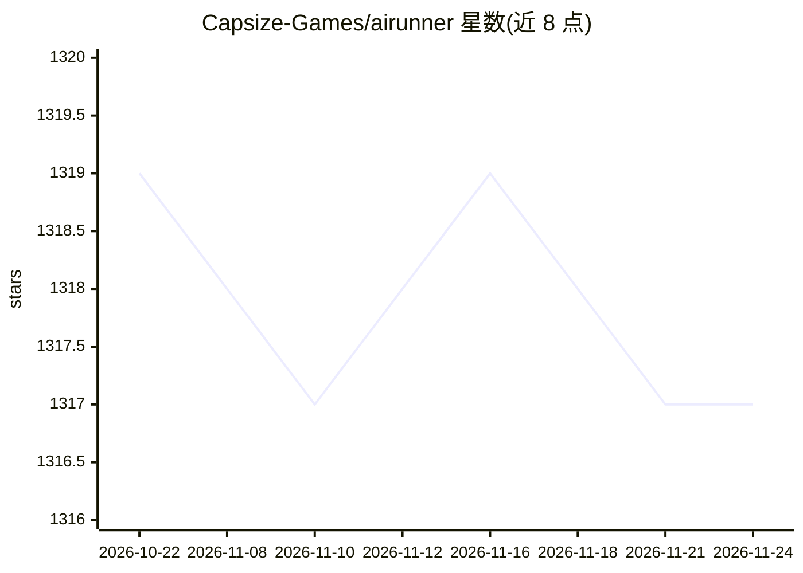

# Capsize-Games/airunner

⭐ 1,317 · Python · GPL-3.0 · 推送 2026-11-23 · [GitHub](https://github.com/Capsize-Games/airunner) · [官网](https://airunner.art) · 个人维护

**面向应用的离线推理引擎：美术、语音对话、LLM 聊天与自动化工作流**

AI Runner 提供 headless 服务形态的模型 worker、运行时编排、持久化与 HTTP/WebSocket API，供其他应用接入；原 Qt 桌面应用与付费桌面商店已退役。仓库拆分为 services（守护进程、FastAPI 路由、下载与持久化）、native（启动器与运行时布局，构建并发布 llama.cpp 与 whisper.cpp sidecar）等包。需要 Python 3.13.3+，Linux CUDA profile 固定 CUDA 12.9 PyTorch 栈。README 明确记录部分 extras（TTS 相关）因依赖 airunner-tts-vendor 在公共索引不可解析，PyPI 发布处于暂停状态；文档声明硬件与语言支持矩阵未经验证，要求随工作负载而变。

## 筛选速览

| 维度 | 判定 | 备注 |
|---|---|---|
| AI 角色 | `ai-ecosystem` | LLM/agent 周边工具 |
| 许可风险 | `viral` | GPL-3.0 |
| 部署形态 | `self-host` | docker 或自建部署 |
| 模型依赖 | — | README 未给出锁定关系 |
| 硬件要求 | — | 无带数字的原话,不猜 |
| 安装摩擦 | `low` | 无编译、无系统依赖或容器化 |
| 成熟度 | — | 结构信号不足 |

## 能力要点

- 模型 worker + FastAPI HTTP/WebSocket API 的 headless 服务架构
- 构建并发布 llama.cpp 与 whisper.cpp sidecar
- extras 按 LLM/STT/art/TTS 拆分，含 linux-release 聚合与 V6 hash lock 离线校验
- 非回环绑定需 AIRUNNER_API_KEY，提供 /health 健康端点

## 适用场景

- 为自有应用提供离线 LLM/语音/美术生成的后端服务
- 在无网络环境下自托管推理 API 并挂载本地 Hugging Face 缓存
- 用 Docker Compose 部署 systemd 化的推理守护进程

## 场景标签

`聊天机器人` `图像生成` `语音合成` `语音识别` · 领域:对话与助手

## 证据(README 行号)

> L3: AI Runner provides model workers, runtime orchestration, persistence, and HTTP/WebSocket APIs for other applications
> L13: |`services/`|Daemon, FastAPI routes, runtime orchestration, downloads, and persistence|
> L16: |`airunner-native`|Builds and publishes the llama.cpp and whisper.cpp sidecars|

## 星数曲线

2026-10-22 1,319 → 2026-11-24 1,317（-2）

---
*卡片 v1 · prompt 1.4 · 生成 2026-11-23 · 置信度 high · 依据 README sha `7ee8d8295362` · [字段定义](../../DATASET.md)*
