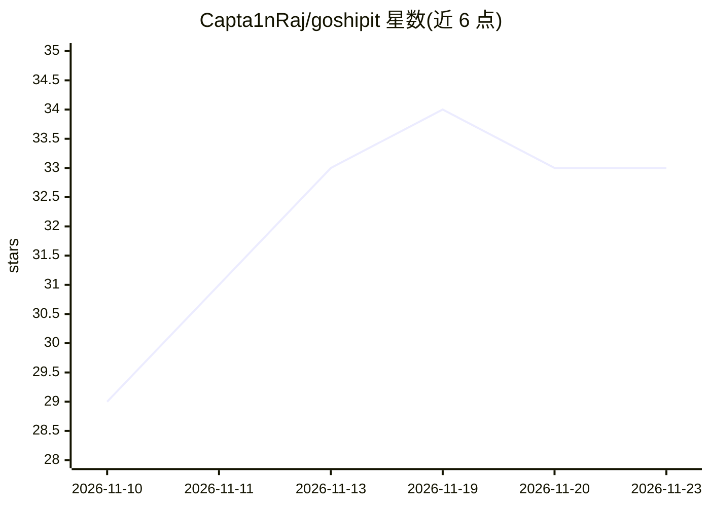

# Capta1nRaj/goshipit

⭐ 33 · JavaScript · Apache-2.0 · 推送 2026-11-18 · [GitHub](https://github.com/Capta1nRaj/goshipit) · [官网](https://www.npmjs.com/package/goshipit) · 个人维护

**面向 AI 编程工具的上线前代码库审计技能**

以 Agent Skills 形式分发的 npm 技能包：安装后在 Claude Code、Codex CLI、Cursor、Gemini CLI 等 10 种 AI 编程工具中通过触发词运行，对代码库执行 210 项检查（密钥、SQLi/XSS、测试覆盖、WCAG 可访问性、SEO、Stripe webhook、GDPR、AI agent 就绪度等 15 类），按严重度扣分（满分 100，可为负）并生成含 file:line 证据与修复步骤的 prelaunch-report.md；支持勾选修复后自动应用安全修复。通过 goshipit.md 配置勾选项；需要 Node.js ≥ 18 与至少一种受支持的 AI 工具。

## 筛选速览

| 维度 | 判定 | 备注 |
|---|---|---|
| AI 角色 | `ai-ecosystem` | LLM/agent 周边工具 |
| 许可风险 | `permissive` | Apache-2.0 |
| 部署形态 | `library` | 以包/库形式分发 |
| 模型依赖 | — | README 未给出锁定关系 |
| 硬件要求 | — | 无带数字的原话,不猜 |
| 安装摩擦 | `low` | 无编译、无系统依赖或容器化 |
| 成熟度 | — | 结构信号不足 |

## 能力要点

- 210 项检查、15 个类别，含安全、合规、可访问性与 Agent 就绪度
- 10 种 AI 编程工具原生加载同一技能目录，安装器自动检测
- severity 加权评分（100 起扣，可为负）并生成带 file:line 证据的报告
- Claude Code 上并行子代理分批执行，支持 auto-fix 安全修复与 diff 预览

## 适用场景

- 上线/合并前用 AI 工具跑一次完整的代码库审计
- 给团队仓库提交可共享的审计配置（--project 安装）
- 按严重度清单逐项修复安全问题

## 场景标签

`网络安全` `代码审查` · 领域:编码与开发

## 证据(README 行号)

> L8: **Pre-launch codebase audit for AI coding tools.**
> L22: goshipit is an Agent Skills skill: one folder (`SKILL.md` + `scripts/` + `assets/` + `references/`) that every tool

## 星数曲线

2026-11-10 29 → 2026-11-23 33（+4）

---
*卡片 v1 · prompt 1.4 · 生成 2026-11-18 · 置信度 high · 依据 README sha `2d3f7385145b` · [字段定义](../../DATASET.md)*
