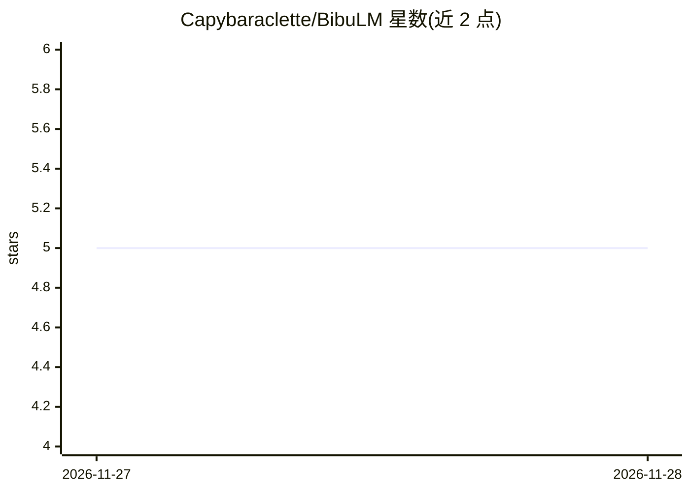

# Capybaraclette/BibuLM

⭐ 5 · Rust · MIT · 推送 2026-11-27 · [GitHub](https://github.com/Capybaraclette/BibuLM) · 个人维护

**本地 LLM 桌面工作台：运行、压测并提供 OpenAI/Anthropic 兼容网关**

基于 Rust + Tauri v2 的桌面应用与 headless 服务器，直接驱动上游 llama.cpp：内置 Runtime Manager 可下载官方 llama.cpp 多后端构建（CUDA/Vulkan/ROCm/SYCL/OpenVINO/CPU），提供 GGUF 元数据检查、加载前 VRAM/RAM 放置估算、KV cache 量化与推理参数控制，并在 127.0.0.1:1234 提供 OpenAI 兼容与 Anthropic /v1/messages 端点，附带 llama-bench 基准矩阵与 Tailscale 组网。安装包覆盖 Windows/macOS/Linux，另有独立 CLI 与 Docker 镜像。

## 筛选速览

| 维度 | 判定 | 备注 |
|---|---|---|
| AI 角色 | `ai-ecosystem` | LLM/agent 周边工具 |
| 许可风险 | `permissive` | MIT |
| 部署形态 | `desktop` | 安装包/桌面程序 |
| 模型依赖 | local-ok | 支持本地模型 |
| 硬件要求 | — | 无带数字的原话,不猜 |
| 安装摩擦 | `low` | 无编译、无系统依赖或容器化 |
| 成熟度 | — | 结构信号不足 |

## 能力要点

- Runtime Manager 拉取官方 ggml-org/llama.cpp 构建，支持多版本并存与自定义编译二进制
- OpenAI 兼容端点与 Anthropic /v1/messages 网关，含模型别名路由与 JIT 加载
- 纯 Rust GGUF v2/v3 检查器，加载前给出 VRAM/RAM 放置估算与适配判定
- BibuLM Link 通过 Tailscale/Headscale 用户态组网连接远程 GPU 服务器

## 适用场景

- 在桌面端直接运行和管理本地 GGUF 模型
- 为 Claude Code 等工具提供本地 OpenAI/Anthropic 兼容 API
- 对比不同量化与加载配置的推理性能
- 在家庭 GPU 服务器上以 headless 方式提供模型服务

## 场景标签

`推理引擎` `模型网关` `模型量化` · 领域:Agent 开发

## 证据(README 行号)

> L7:  A lightweight, native Rust + WebView (Tauri v2) desktop workbench and headless server for running, benchmarking, an
> L36: ### Drop-in OpenAI &amp; Anthropic gateway
> L96: |**API Gateway**|Local `axum` reverse-proxy gateway on `http://127.0.0.1:1234` · OpenAI endpoints (`/v1/models`, `/

## 星数曲线

2026-11-27 5 → 2026-11-28 5（+0）

---
*卡片 v1 · prompt 1.4 · 生成 2026-11-27 · 置信度 high · 依据 README sha `bfe1a355f8e7` · [字段定义](../../DATASET.md)*
