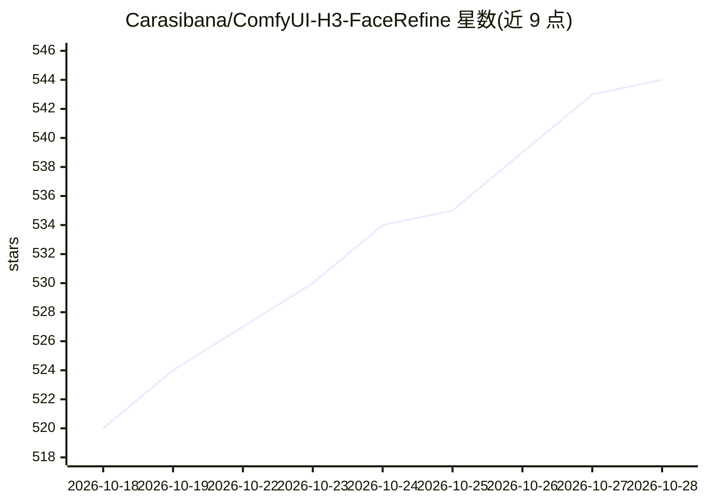

# Carasibana/ComfyUI-H3-FaceRefine

⭐ 544 · Python · MIT · 推送 2026-09-13 · [GitHub](https://github.com/Carasibana/ComfyUI-H3-FaceRefine) · 个人维护

**ComfyUI 节点集：修复 MiniMax H3 视频中远处小脸的画质**

面向 ComfyUI + MiniMax H3 视频生成流程的自定义节点集：当人脸在画面中占比过小导致 H3 渲染质量下降时，逐帧跟踪人脸、裁切至画布尺寸交给 H3 重新生成，再合成回原视频。核心节点包括 H3 Load Video + Face Select（一次解码中找出人脸与硬切分）、H3 Face Track + Crop（跟踪与裁切，支持九种主体选择模式）与逐帧去噪；1.1.2 修复了跟踪丢失后跳到他人的问题。仅人脸检测模型为节点必需，其余模型随 H3 生成管线一并使用；通过 git clone 安装到 custom_nodes 目录。

## 筛选速览

| 维度 | 判定 | 备注 |
|---|---|---|
| AI 角色 | `ai-ecosystem` | LLM/agent 周边工具 |
| 许可风险 | `permissive` | MIT |
| 部署形态 | `library` | 以包/库形式分发 |
| 模型依赖 | — | README 未给出锁定关系 |
| 硬件要求 | — | 无带数字的原话,不猜 |
| 安装摩擦 | `low` | 无编译、无系统依赖或容器化 |
| 成熟度 | — | 结构信号不足 |

## 能力要点

- 逐帧人脸跟踪-裁切-H3 重生成-回贴合成的视频级人脸修复流程
- PySceneDetect 硬切检测使主体选择与平滑按镜头独立处理
- 九种主体选择模式与丢失主体时的插值/淡出处理
- GGUF 加载对可将 H3 显存占用压至 12 GB

## 适用场景

- H3 视频中人物较小导致脸部模糊时做后期修复
- 多镜头/多人视频中指定主体人脸做画质增强
- 动画素材配专用检测模型做人脸修复

## 场景标签

`视频生成` `图像视频处理` · 领域:内容生成

## 证据(README 行号)

> L3: **A ComfyUI custom node set to refine and improve the quality of small faces in MiniMax H3 video.**
> L119: |ComfyUI with MiniMax H3 support|H3's own nodes are **core** (`comfy_extras/nodes_minimax_h3.py`), not an add-on, 

## 星数曲线

2026-10-18 520 → 2026-10-28 544（+24）

---
*卡片 v1 · prompt 1.4 · 生成 2026-10-21 · 置信度 mid · 依据 README sha `7b1f3fd3f0cb` · [字段定义](../../DATASET.md)*
