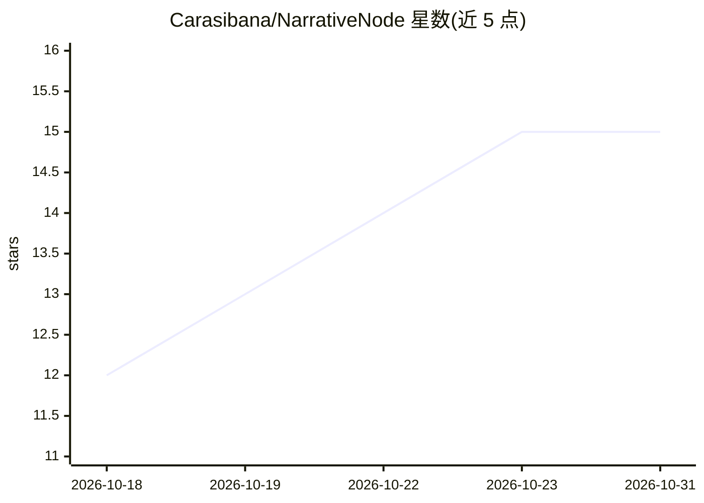

# Carasibana/NarrativeNode

⭐ 15 · JavaScript · NOASSERTION · 推送 2026-07-09 · [GitHub](https://github.com/Carasibana/NarrativeNode) · [官网](https://carasibana.github.io/NarrativeNode/) · 个人维护

**面向写作者的节点式剧情可视化规划工具，AI 集成完全可选**

为构建复杂故事的写作者提供的可视化剧情规划应用：在无限缩放画布上以场景节点与连线组织故事，实体（角色/地点/物品/派系/自定义）在 Setup Node 定义后按场景记录变更，变更沿连接图向前传播并自动标记矛盾冲突。区分时间序与叙事序：画布按时间序排列，POV 系统定义读者视角的叙事顺序，导出遵循 POV 序。另追踪角色知识/认知、处境、动机与观点。以桌面应用形式提供安装包，AI 聊天与工具调用集成为完全可选功能。

## 筛选速览

| 维度 | 判定 | 备注 |
|---|---|---|
| AI 角色 | `ai-enhanced` | 去掉 AI 部分产品仍成立 |
| 许可风险 | `none` | NOASSERTION |
| 部署形态 | `desktop` | 安装包/桌面程序 |
| 模型依赖 | — | README 未给出锁定关系 |
| 硬件要求 | — | 无带数字的原话,不猜 |
| 安装摩擦 | `low` | 无编译、无系统依赖或容器化 |
| 成熟度 | — | 结构信号不足 |

## 能力要点

- 实体状态沿场景图自动向前传播，冲突以审查标记浮现
- 画布显示时间序、POV 路径定义叙事序，支持非线性叙事
- 知识/认知追踪：可查询某场景中谁知道某秘密
- 5 种内置实体类型与可配置自定义类型、5 种自定义属性类型

## 适用场景

- 多 POV、闪回等非线性复杂剧情的整体规划
- 追踪物品易手、角色关系演变等状态连续性
- 导出时按 POV 顺序生成符合读者体验的叙事稿

## 场景标签

 · 领域:创作/写作工具

## 证据(README 行号)

> L5: **A visual plot planner for writers. Built like a node editor, designed for storytellers.**
> L19: NarrativeNode is a planning tool for writers who are building complex stories. Instead of juggling separate charact
> L36: NarrativeNode treats your story as a living graph. The state of every character, location, and item is computed aut

## 星数曲线

2026-10-18 12 → 2026-10-31 15（+3）

---
*卡片 v1 · prompt 1.4 · 生成 2026-10-31 · 置信度 mid · 依据 README sha `5ffab00e463e` · [字段定义](../../DATASET.md)*
