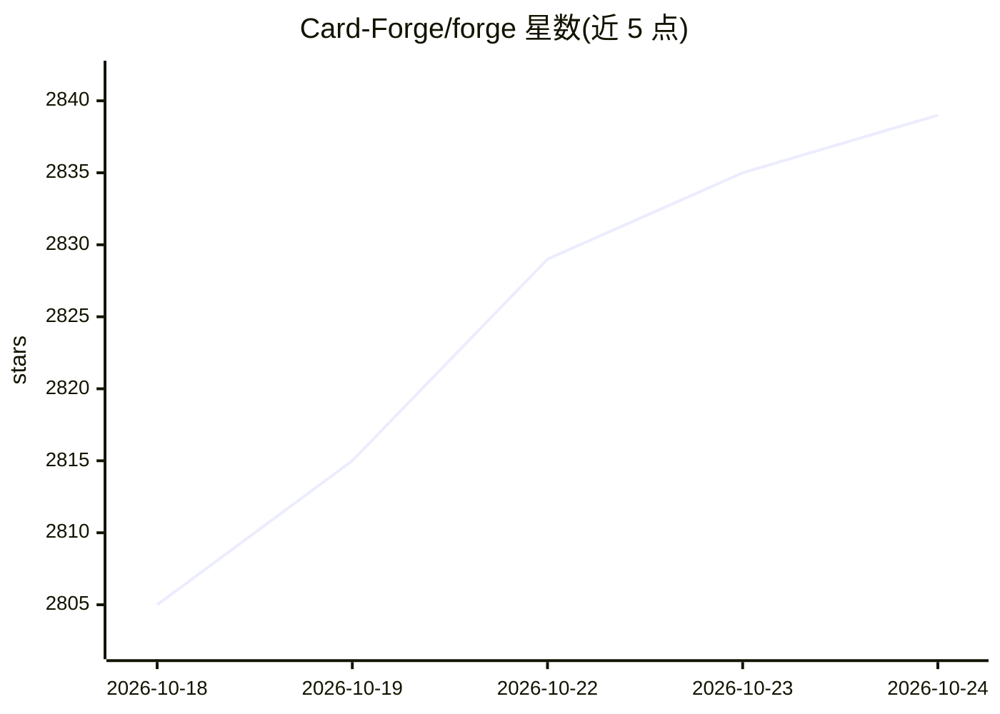

# Card-Forge/forge

⭐ 2,839 · Java · GPL-3.0 · 推送 2026-10-23 · [GitHub](https://github.com/Card-Forge/forge) · [官网](https://card-forge.github.io/forge/) · 组织维护

**跨平台万智牌（MTG）规则引擎与单人/在线对局客户端**

Java 编写的开源万智牌规则引擎与游戏客户端，支持 Windows/Mac/Linux/Android，iOS 处于早期阶段（自行构建 IPA 并自签）。桌面版需 Java 17 或更高版本，Android 需 Android 11 与至少 6GB RAM。玩法包含带大世界地图的冒险模式、任务模式，以及对抗 AI 的 Sealed/Draft/Commander/Cube 等多种赛制，也支持在线对战；架构可扩展，鼓励开发者贡献新卡与功能。与威世智无隶属关系，GPL-3.0 许可。

## 筛选速览

| 维度 | 判定 | 备注 |
|---|---|---|
| AI 角色 | `ai-enhanced` | 去掉 AI 部分产品仍成立 |
| 许可风险 | `viral` | GPL-3.0 |
| 部署形态 | `None` |  |
| 模型依赖 | — | README 未给出锁定关系 |
| 硬件要求 | — | 无带数字的原话,不猜 |
| 安装摩擦 | `medium` | 含编译或系统依赖之一 |
| 成熟度 | `idea` | |

## 能力要点

- 跨平台支持 Windows/Mac/Linux/Android，iOS 早期支持
- 冒险模式含大世界地图探索、AI 对手与卡牌收集
- 对抗 AI 的 Sealed/Draft/Commander/Cube 多种赛制
- Java 可扩展架构，支持社区贡献新卡与功能

## 适用场景

- 离线或在线游玩万智牌对局
- 体验带大世界探索的冒险模式与任务模式
- 与 AI 进行限制赛、轮抽、指挥官等赛制对局

## 场景标签

 · 领域:游戏/卡牌模拟

## 证据(README 行号)

> L8: **Forge** is a dynamic and open-source **Rules Engine** tailored for **Magic: The Gathering** enthusiasts. Developed
> L41: - Challenge diverse AI opponents.
> L51: ### 🤖 AI Formats

## 星数曲线

2026-10-18 2,805 → 2026-10-24 2,839（+34）

---
*卡片 v1 · prompt 1.4 · 生成 2026-10-21 · 置信度 high · 依据 README sha `6c14a47bf58c` · [字段定义](../../DATASET.md)*
