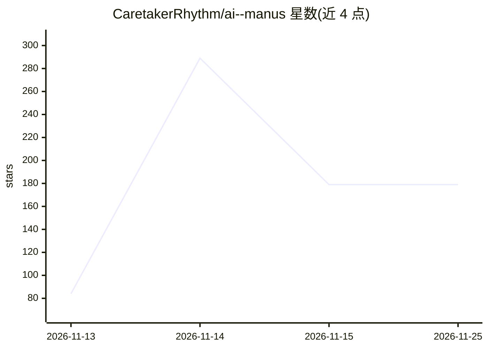

# CaretakerRhythm/ai--manus

⭐ 179 · Apache-2.0 · 推送 2026-11-15 · [GitHub](https://github.com/CaretakerRhythm/ai--manus) · 个人维护

**自主执行代码与控制浏览器的通用 AI Agent 应用**

README 以产品介绍形式描述 Manus：一个代表用户运行代码、控制浏览器、执行多步骤任务的自主 AI agent，面向家庭、学习与轻量办公等小规模场景，用户无需编程背景。功能包括自主执行脚本、网页导航与填表、后台待命的助手模式、跨会话保持工作流模式。README 给出兼容性表（4GB 内存起步、推荐 8GB）与使用步骤说明，但未提供安装命令、源码结构或技术实现细节；仓库主题标签含 anthropic/openai 等，但正文未展开。

## 筛选速览

| 维度 | 判定 | 备注 |
|---|---|---|
| AI 角色 | `ai-native` | 本体是模型或模型工具 |
| 许可风险 | `permissive` | Apache-2.0 |
| 部署形态 | `None` |  |
| 模型依赖 | — | README 未给出锁定关系 |
| 硬件要求 | — | 无带数字的原话,不猜 |
| 安装摩擦 | `low` | 无编译、无系统依赖或容器化 |
| 成熟度 | — | 结构信号不足 |

## 能力要点

- 自主执行代码与脚本
- 浏览器控制：导航网页、填表、抓取信息
- 代码与浏览器动作可在同一任务流中衔接
- 面向小规模场景的后台个人助手模式

## 适用场景

- 让学生整理研究笔记、跑小脚本
- 远程办公者从多个网页收集数据
- 把重复性的小任务交给后台 agent 处理

## 场景标签

`AI 助手` `浏览器自动化` `编码 Agent` · 领域:效率与自动化

## 证据(README 行号)

> L10: - **Autonomous Code Execution:** Manus AI agent runs code on its own to complete tasks, so you can focus on decisio
> L18: Manus is an autonomous AI agent designed to run code and control a browser on your behalf. Instead of acting like a

## 星数曲线

2026-11-13 84 → 2026-11-25 179（+95）

---
*卡片 v1 · prompt 1.4 · 生成 2026-11-17 · 置信度 low · 依据 README sha `0f78ee3a5dd2` · [字段定义](../../DATASET.md)*
