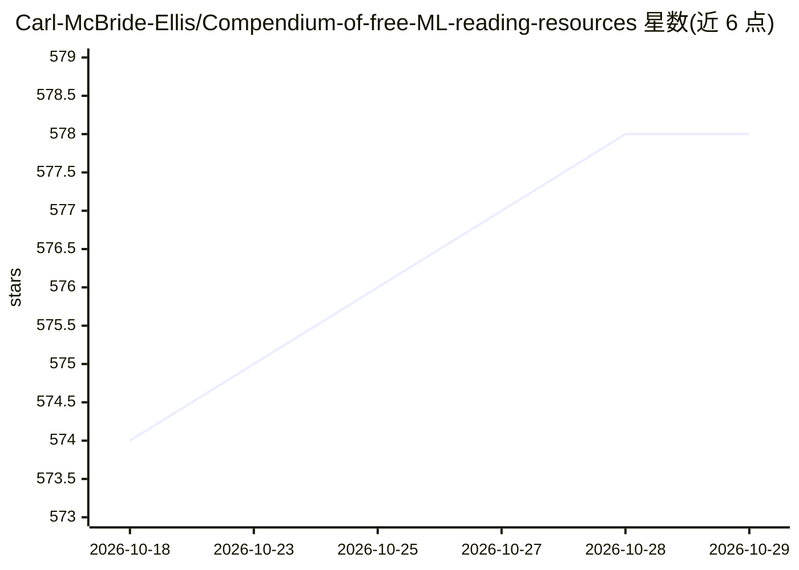

# Carl-McBride-Ellis/Compendium-of-free-ML-reading-resources

⭐ 578 · 推送 2026-10-22 · [GitHub](https://github.com/Carl-McBride-Ellis/Compendium-of-free-ML-reading-resources) · 个人维护

**免费机器学习阅读资源清单：198 本书籍按 18 类组织**

由个人维护的机器学习免费阅读资源汇编：收录 198 本书籍（含 arXiv 论文），覆盖 EDA 与数据清洗、ML 数学、统计与概率、优化、线性回归、机器学习、深度学习、强化学习、因果推断、共形预测、时间序列预测、NLP 与 LLM 等 18 个类别。每条目以图标区分 PDF 文件与 HTML 在线书，所有资源均由作者或出版方免费公开。README 即内容本体，无安装或运行方式。

## 筛选速览

| 维度 | 判定 | 备注 |
|---|---|---|
| AI 角色 | `ai-knowledge` | 知识聚合/清单类 |
| 许可风险 | `none` | — |
| 部署形态 | `None` |  |
| 模型依赖 | — | README 未给出锁定关系 |
| 硬件要求 | — | 无带数字的原话,不猜 |
| 安装摩擦 | `low` | 无编译、无系统依赖或容器化 |
| 成熟度 | — | 结构信号不足 |

## 能力要点

- 收录 198 本免费书籍，按 18 个主题类别组织
- 以图标区分 PDF 文件与 HTML 在线书两种形式
- 覆盖从数学基础到深度学习、因果推断、共形预测的完整谱系
- 所有资源由作者/出版方免费公开，arXiv 论文本身免费

## 适用场景

- 系统查找机器学习某子领域（如优化、贝叶斯统计）的免费教材
- 按学习路径从数学基础进阶到深度学习与强化学习
- 查找 R 语言或 Python 的数据科学实践书籍

## 场景标签

`精选清单` · 领域:学习与行业

## 证据(README 行号)

> L1: # Compendium of free ML reading resources
> L25: Total number of books: **198**

## 星数曲线

2026-10-18 574 → 2026-10-29 578（+4）

---
*卡片 v1 · prompt 1.4 · 生成 2026-10-21 · 置信度 high · 依据 README sha `a0c5b6cf13ce` · [字段定义](../../DATASET.md)*
