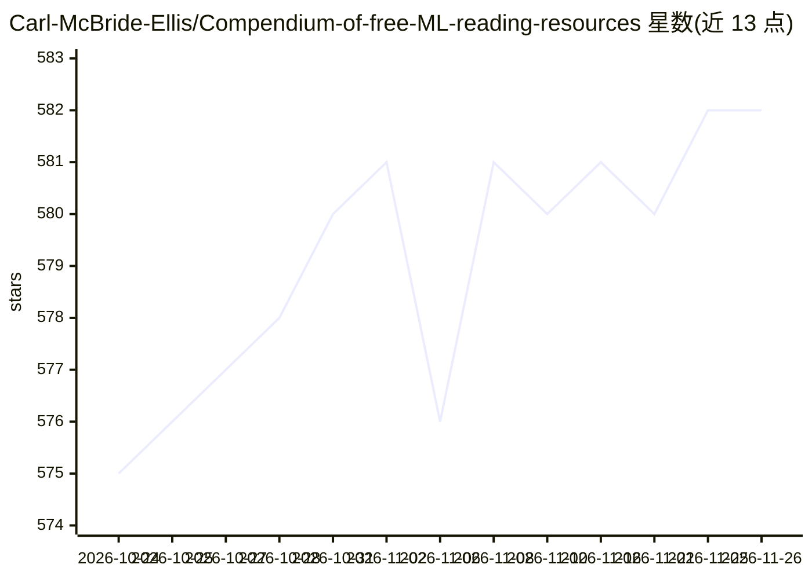

# Carl-McBride-Ellis/Compendium-of-free-ML-reading-resources

⭐ 582 · 推送 2026-11-07 · [GitHub](https://github.com/Carl-McBride-Ellis/Compendium-of-free-ML-reading-resources) · 个人维护

**机器学习免费阅读资源清单：收录 200 本免费书籍与 arXiv 论文**

按 18 个主题分类整理的机器学习免费阅读资源汇编，覆盖数据清洗、数学基础、统计与概率、优化、机器学习、深度学习、强化学习、NLP/LLM、因果推断、共形预测、时间序列等方向，共收录 200 本由作者或出版方免费公开的书籍及 arXiv 论文，每条目标注 PDF 或 HTML 电子书格式，并附目录与各分类计数。README 未涉及任何安装或运行步骤，仓库本体即清单内容。

## 筛选速览

| 维度 | 判定 | 备注 |
|---|---|---|
| AI 角色 | `ai-knowledge` | 知识聚合/清单类 |
| 许可风险 | `none` | — |
| 部署形态 | `None` |  |
| 模型依赖 | — | README 未给出锁定关系 |
| 硬件要求 | — | 无带数字的原话,不猜 |
| 安装摩擦 | `low` | 无编译、无系统依赖或容器化 |
| 成熟度 | — | 结构信号不足 |

## 能力要点

- 收录 200 本免费书籍，按 18 个主题分类组织
- 每条目标注 PDF 或 HTML 电子书格式
- 包含 arXiv 论文及作者/出版方免费公开的书籍

## 适用场景

- 系统学习机器学习数学基础与统计知识
- 查找深度学习、强化学习、因果推断等方向的免费教材
- 为教学或自学课程挑选参考书目

## 场景标签

`精选清单` · 领域:学习与行业

## 证据(README 行号)

> L1: # Compendium of free ML reading resources
> L25: Total number of books: **200**
> L27:  Note: All books listed here have been made freely available by their respective authors/publishers, and all arXiv 

## 星数曲线

2026-10-24 575 → 2026-11-26 582（+7）

---
*卡片 v1 · prompt 1.4 · 生成 2026-11-25 · 置信度 high · 依据 README sha `3fb5543f7761` · [字段定义](../../DATASET.md)*
