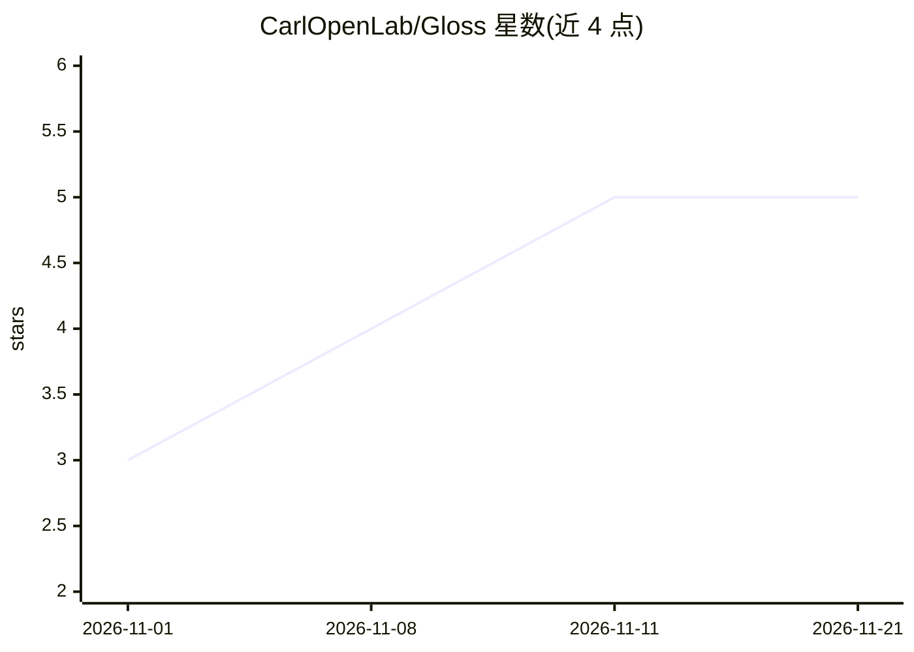

# CarlOpenLab/Gloss

⭐ — · [GitHub]() · 组织维护 · 中文 README

**面向开发者审查 diff 的原生 Git 客户端，含 AI 风险扫描**

纯 Go 编写的跨平台桌面 Git 客户端，围绕 diff 审查组织功能：暂存区一键送入 LLM 生成按 Critical/High/Medium/Low 分级的风险审计报告并锚定到文件行号；从 staged diff 自动起草 Conventional Commits 提交信息与分支命名；提供 GPU 渲染的分支拓扑图、逐 hunk 暂存、冲突可视解决、Ghostty 终端与三层 Git 配置管理。单二进制约 20MB，macOS/Windows/Linux 提供预编译包，也可从 Go 1.27+ 源码构建。

## 筛选速览

| 维度 | 判定 | 备注 |
|---|---|---|
| AI 角色 | `ai-enhanced` | 去掉 AI 部分产品仍成立 |
| 许可风险 | `permissive` | — |
| 部署形态 | `desktop` | 安装包/桌面程序 |
| 模型依赖 | local-ok | 支持本地模型 |
| 硬件要求 | — | 无带数字的原话,不猜 |
| 安装摩擦 | `low` | 无编译、无系统依赖或容器化 |
| 成熟度 | — | 结构信号不足 |

## 能力要点

- Pre-Flight 风险审计：LLM 扫描暂存 diff，输出四级风险并锚定文件与行号
- 从 staged diff 起草 Conventional Commits 提交信息与分支命名
- GPU 直接渲染拓扑图，零 WebView，单二进制约 20MB
- 内置多 LLM 提供商预设，可拖拽排序

## 适用场景

- 合并 PR 前扫描暂存改动中的硬编码密钥与注入风险
- 为暂存的改动自动生成规范的提交信息
- 图形化管理分支拓扑、逐 hunk 暂存与冲突解决

## 场景标签

`代码审查` · 领域:编码与开发

## 证据(README 行号)

> L35: * **🛡️ Pre-Flight AI Risk Auditing**: One-click scanning of your staged diff. LLMs highlight hardcoded credentials,
> L78: * **Multi-Provider AI Engine**: Built-in presets for **Anthropic Claude**, **OpenAI**, **DeepSeek**, **Kimi (Moonsh

## 星数曲线

2026-11-01 3 → 2026-11-21 5（+2）

---
*卡片 v1 · prompt 1.4 · 生成 2026-11-21 · 置信度 high · 依据 README sha `30e22091b01d` · [字段定义](../../DATASET.md)*
